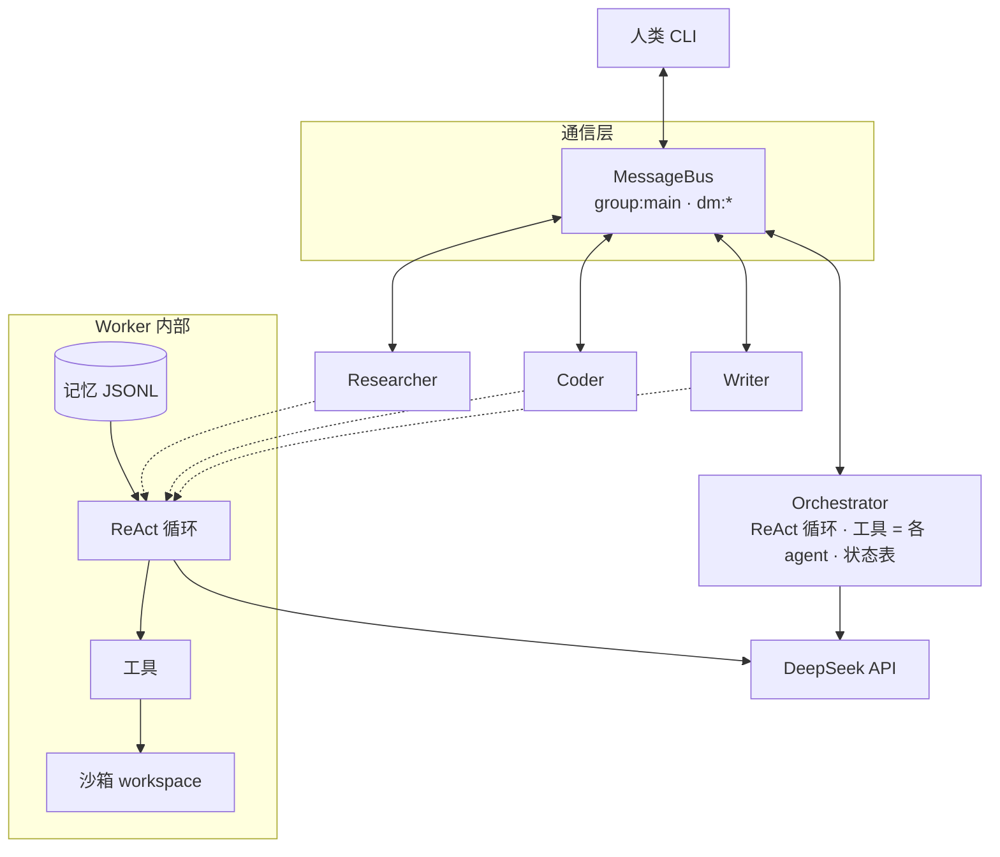
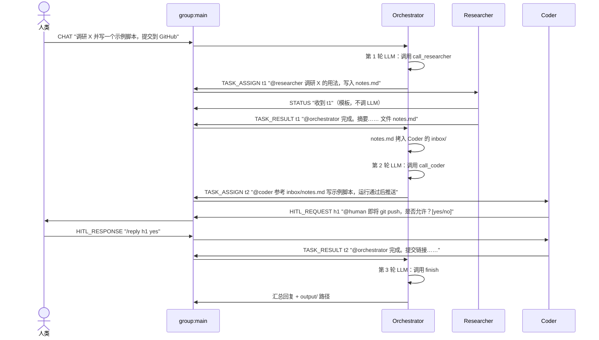
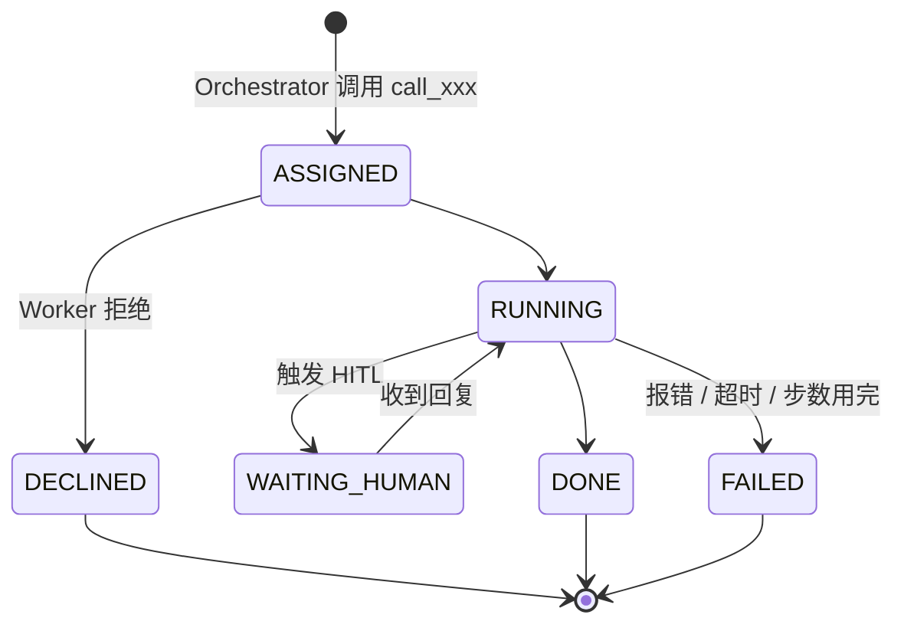
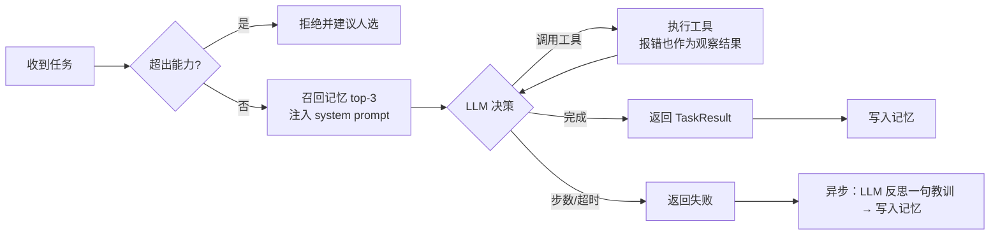

# 框架设计决定

> 用途：对齐框架设计，定完就可以确定接口、分头写代码。
> 原则：**优先看测试集的任务完成率和执行时间**。所以规格要求的功能都要有，但方案要向完成率高、完成速度快的方向考虑。
> LLM：**DeepSeek API**（OpenAI 兼容接口，`deepseek-chat`，使用 function calling）。

---

## 0. 一页结论

| # | 问题 | 决定 | 理由 |
|---|---|---|---|
| D1 | 协作拓扑 | **中心化 + agent as a tool**：Orchestrator 本身是一个 ReAct 循环，它的工具就是各个 Worker（`call_researcher` 等），每一步看到结果后再决定下一步 | 能根据实际结果调整计划、处理失败，完成率高；每次调用只指向一个 agent，不会出现"一个子任务需要两个 agent 的能力"的情况 |
| D2 | Agent 角色 | Orchestrator + Researcher / Coder / Writer 三个 Worker；Git、文件操作作为 Coder 的工具 | agent 越多，路由出错和通信越多 |
| D3 | 拆分粒度 | **按 agent 拆，不按技能拆**：每次调用的 goal 必须是该 agent 独立能完成的 | 跨 agent 的子任务交给一个人做，必然缺能力或缺工具 |
| D4 | 角色协商 | Orchestrator 的 LLM 根据工具描述选人；被调用的 agent 可以**拒绝并建议人选**，Orchestrator 读到后改派 | 真正的协商，而不是固定路由表上的走过场；不增加额外的 LLM 调用 |
| D5 | 记忆影响分工 | 每个 agent 根据自己的记忆生成**能力档案**，附在对应工具的描述里 | Orchestrator 选人时能参考历史表现，记忆会影响分工 |
| D6 | 并行 | Orchestrator 一轮返回多个 tool call 时并发执行 | 直接缩短总耗时 |
| D7 | 群聊 | **公开群聊**：全部 agent 都是群成员，派活（@agent）和交结果都发在群里；只有被点名的 agent 处理；聊天原文不自动进入 LLM 上下文，改为注入共享会话看板（D17） | 协作过程对人类完全可见；发消息是微秒级操作，只要其他 agent 不调 LLM 去读，就不会变慢 |
| D8 | 私聊 | 人类可以私聊任一 agent，该 agent 直接执行或回答；私聊任务支持再委派 | 私聊是规格要求的拓扑之一 |
| D9 | 再委派 | Worker 的工具里也有其他 agent 的 `call_xxx`（不含自己），深度上限 2。群聊和私聊任务**统一经 Orchestrator 的路由代码**登记、检查限制、转发；区别只在于消息发到哪里：群聊任务公开发在群里，私聊任务只发在私聊频道 | 路由由代码完成、不调 LLM，与点对点相比没有可感知的耗时差别；只保留一条代码路径，减少出错；深度和防循环限制防止委派导致超时 |
| D10 | 失败处理 | 两层都把错误当作观察结果返回给 LLM，不抛异常；由 Orchestrator 决定重试、改写或换人；同一目标最多重试 2 次；最后仍失败就汇报部分结果 | 一次崩溃就算失败；部分完成也能拿到子任务完成率 |
| D11 | 循环上限 | Orchestrator 最多 8 轮；Worker 每个任务最多 12 步，并设单任务超时 | 防止卡死拖垮总时间 |
| D12 | HITL | 规则触发；**在群里由发起的 agent 直接 @human 弹出请求**，带编号以便并行时区分；私聊里发起的任务则在私聊里请求；评测时由 AutoResponder 立即应答 | 人类在群里能看到请求的上下文；测试集无人值守也能跑完，且不因等人而耗时 |
| D13 | 记忆 | 每个 agent 一个 JSONL；关键词召回 top-3；**反思只在失败时调 LLM**，并且在返回结果之后异步执行 | 进化有效，又不增加关键路径上的耗时 |
| D14 | 沙箱 | 每个 agent 一个独立 workspace；产物由 Orchestrator 拷到下游 agent 的 `inbox/`；最终产物汇总到 `data/output/<run_id>/` | 隔离满足规格；产物位置固定，评测检查器好写 |
| D15 | 沙箱实现 | 先用 LocalSandbox 开发；DockerSandbox 使用**常驻容器**（每个 agent 启动一次，之后只 exec） | 避免每条命令都启动容器带来的额外耗时 |
| D16 | 练习集 | 测试集发布前自建约 20 个任务，覆盖 5 类题型，每周跑一次 | 测试集未知，只能靠练习集提前暴露失败模式 |
| D17 | 共享上下文 | **会话看板**：由代码从结构化消息中维护会话的进展和重要信息（人类原话、已完成事项及产物、ID、未办事项），agent 开始任务时自动注入；**不用 LLM 做摘要** | 同一会话的进展在 agent 间共享；文件名、ID 这类信息一个字都不会丢；不增加 LLM 调用 |

下面是展开说明，需要讨论的点都标了 **【待确认】**，需要实测的点标了 **【待验证】**。

---

## 1. 总体架构



三个 Worker 是同一个 `WorkerAgent` 类，只是角色配置不同：system prompt、可用工具、给 Orchestrator 看的能力描述。

| 角色 | 负责 | 工具 |
|---|---|---|
| Researcher | 搜索、调研、整理资料 | 网络搜索、网页抓取、文件读写 |
| Coder | 写代码并运行、文件操作、Git | 文件 CRUD、执行 Python、Git |
| Writer | 撰写 Markdown / txt 文档 | 文件读写 |

**关键点：agent 工具的底层仍然走消息总线。** `call_coder()` 不是直接调用 Python 函数，而是把参数包装成 `TASK_ASSIGN`（`receiver=coder`，正文为 `@coder <goal>`）发到 `group:main`，再等待 `reply_to` 指向这条消息的 `TASK_RESULT`。agent as a tool 决定"怎么选人"，公开群聊决定"消息谁能看到"，两者互不影响。因此群聊进度广播、`/status`、HITL、状态表都照常工作；Worker 只管收消息、执行、回结果，不需要知道自己是被当作工具调用的。

---

## 2. 一次任务怎么跑



简单任务（比如"写一个冒泡排序脚本"）就是"调用一次 Coder，然后 `finish`"，只需两轮，不需要单独做快速通道。

### 2.1 Orchestrator 循环

**工具列表：**

```python
tools = [
    call_researcher(goal: str, context: str = "", files: list[str] = []),
    call_coder(goal: str, context: str = "", files: list[str] = []),
    call_writer(goal: str, context: str = "", files: list[str] = []),
    ask_human(question: str, options: list[str] = []),   # HITL：描述含糊时请求澄清
    finish(summary: str, deliverables: list[str]),        # 结束，汇报结果
]
```

- `goal`：交给该 agent 的单一目标，必须是它独立能完成的（D3）。
- `context`：只针对这次调用的补充说明。会话的整体进展、上游结果和产物已经在会话看板里（3.1），不必重复写。
- `files`：之前调用产出的文件，Orchestrator 会把它们拷进被调用 agent 的 `inbox/`（D14）。

**system prompt 的要点：**

1. 每个 agent 能做什么、不能做什么，以及它的能力档案（D5）；
2. 拆分规则：每次调用只交给一个 agent 它能独立完成的目标；需要多种能力就拆成多次调用；
3. 互不依赖的调用要放在同一轮里发出，以便并行；
4. 交付物只能是 `.md` / `.txt` / 代码文件；
5. 任务完成后立即调用 `finish`，不要多余的确认轮次。

**循环控制：**

- 每轮 LLM 可能返回多个 tool call，用 `asyncio.gather` 并发执行（D6）。**【待验证】** DeepSeek 一次响应是否稳定返回多个 tool call；如果不稳定，就在 prompt 里加强要求，或接受串行执行。
- 最多 8 轮；用完时强制根据已有结果汇报。
- **控制上下文**：agent 的结果只回传摘要（≤ 1500 字）、产物路径和是否成功，不回传全文。
- 每次 `call_xxx` 都在状态表里登记成一个子任务，用于 `/status` 和评测统计。

### 2.2 协商：拒绝与改派（D4）

Worker 接到任务后，如果发现超出自己的能力（例如 Writer 被要求运行代码），会直接拒绝，不开始执行：

```json
{"success": false, "error": "declined", "reason": "需要运行 Python", "suggest": "coder"}
```

这条结果作为工具返回值回到 Orchestrator，由它改派或重新拆分。拒绝不计入失败，也不占重试次数。判断是否拒绝放在 Worker 的 ReAct 第一步里完成，不额外调 LLM。

### 2.3 能力档案：记忆如何影响分工（D5）

每个 agent 根据自己的记忆生成一段档案，在每个根任务开始时刷新，拼进对应 `call_xxx` 工具的 description：

```
call_coder: 编写并运行 Python 代码、文件操作、Git 提交推送。
  近期表现：代码类 8/10 成功，git 类 3/3 成功。
  已知短板：爬取需要 JS 渲染的网页常失败；pip 安装超时。
```

- 成功次数是统计出来的，不调 LLM；
- "已知短板"取最近几条失败记录里的教训（D13），不调 LLM；
- 档案总长度控制在约 300 字以内，避免撑大 Orchestrator 的 prompt。

---

## 3. 群聊与私聊协议

### 频道

| 频道 | 成员 | 用途 |
|---|---|---|
| `group:main` | 人类 + 全部 agent | 下发任务、进度广播、最终汇报、人类插话 |
| `dm:<a>:<b>`（a、b 按字母序） | 两方 | 人类与 agent 私聊 |

**公开群聊**：全部 agent 都是 `group:main` 的成员。派活（`TASK_ASSIGN`，正文 `@agent <goal>`）和交结果（`TASK_RESULT`，正文为摘要和产物路径）都发在群里，包括 agent 之间的再委派。群里的聊天记录就是完整的协作过程，例如：

```
人类          : 调研 X 并写一个示例脚本，提交到 GitHub
Orchestrator : @researcher 调研 X 的用法，要点写入 notes.md
Researcher   : 收到 t1
Researcher   : @orchestrator 完成。摘要：…… 文件：notes.md
Orchestrator : @coder 参考 notes.md 写一个示例脚本，运行通过后推送
Coder        : 收到 t2
Coder        : @researcher 需要 X 的认证方式说明          ← 再委派，同样公开
Researcher   : @coder ……
Coder        : [h1] @human 即将 git push，是否允许？[yes/no]   ← HITL 在群里弹出
人类          : /reply h1 yes
Coder        : @orchestrator 完成。提交链接：……
Orchestrator : 全部完成。交付物：output/……
```

### 群里的规则（D7，保证速度）

1. **收到不等于处理**：每个成员都会收到群消息，但只有 `receiver` 是自己的 agent 才行动，其他 agent 不调 LLM。
2. **人类消息**：带 `@agent` 时由被点名的 agent 回应；没有点名时只有 Orchestrator 回应。
3. **聊天原文不自动进入 LLM 上下文，共享的是会话看板**：消息对所有 agent 都可见（总线保存完整群历史），但不把聊天原文整段塞进 prompt，否则 prompt 会随聊天记录不断变长。会话的进展和重要信息通过会话看板（3.1）自动注入；需要原文时调用 `read_group(limit)` 按需读取。
4. **只发人能读懂的内容**：任务、结果摘要、关键状态（收到、失败、等待人类）。"收到""等待确认"这类消息用模板拼接，不调 LLM。工具每一步的细节只发给 Orchestrator 更新状态表，不进群。

发群消息本身是内存队列操作（微秒级），只要遵守以上规则，公开群聊不会带来可感知的耗时。

### 3.1 共享会话看板（D17）

同一个会话里的进展和重要信息必须在 agent 之间共享。做法是由 Orchestrator 维护一块**会话看板**（`SessionBoard`），agent 开始任务时把它注入 prompt。

#### 不用 LLM 做摘要，而是用代码维护结构化状态

如果让 LLM 把聊天记录"总结一下"，会有三个问题：每次多一次 LLM 调用；文件名、ID、链接容易被改写或漏掉；未办事项可能被总结丢。

而看板需要的信息其实都已经以结构化形式存在：`TASK_ASSIGN / TASK_RESULT / HITL_*` 消息的 payload、状态表、人类的原始消息。所以看板由代码在每条消息到达时直接更新，**不调 LLM、不丢字段**。唯一由 LLM 写的文字是每个 Worker 结果里的 `summary`，这是 Worker 本来就要输出的最终回答。

#### 看板保存什么

| 部分 | 内容 | 来源 | 截断规则 |
|---|---|---|---|
| 人类原话 | 本会话中人类的每条要求和插话，**原文** | 人类的 `CHAT` 消息 | 不截断 |
| HITL 决定 | 每个请求的编号、问题、人类的回答 | `HITL_REQUEST / RESPONSE` | 不截断 |
| 已完成事项 | 子任务 ID、负责 agent、目标、结果摘要、**产物文件名**、关键标识（提交 hash、链接等） | `TASK_RESULT` | 摘要可截断，ID、文件名、标识不截断 |
| 失败与拒绝 | 子任务 ID、负责 agent、原因 | `TASK_RESULT(success=false)` | 原因截断到一句 |
| **未办事项** | 见下文 | 多处汇总 | 不截断 |
| 早先的根任务 | 一个会话可能包含多个根任务；已结束的根任务压缩成一行：`finish` 总结的第一句 + 交付物 | 状态表、`finish(summary, deliverables)` | 只留一行 |

#### 未办事项从哪里来

1. **正在执行**：状态表中 `RUNNING / WAITING_HUMAN` 的子任务，以及谁在负责。
2. **等待人类**：尚未回复的 HITL 请求编号。
3. **Worker 报告的遗留问题**：`TaskResult` 新增 `open_issues: list[str]` 字段，Worker 在结果里写明没做完或需要别人跟进的事，例如"测试用例未覆盖异常输入"。
4. **Orchestrator 的剩余计划**：Orchestrator 每一轮发出 tool call 时，在同一个响应的文字部分写一行"剩余步骤：……"，代码取最新的一行存进看板。这样不需要额外的 LLM 调用。
5. **失败后尚未处理的子任务**：失败了、但 Orchestrator 还没有重试或放弃的。

#### Worker 结果的格式（LI Heyang 负责，保证看板信息完整）

Worker 的最终回答按固定字段返回，而不是一段自由文本：

```json
{
  "success": true,
  "summary": "用 requests 实现了 X 的示例，运行通过并推送。",
  "artifacts": ["demo_x.py", "README.md"],
  "refs": {"commit": "a1b2c3d", "url": "https://github.com/..."},
  "open_issues": ["未处理 API 限流"]
}
```

`artifacts` 和 `refs` 由代码根据工具调用记录自动补全（写过哪些文件、git 返回的 hash），不完全依赖 LLM 填写，避免漏报。

#### 注入方式

渲染出来的看板示例：

```
## 会话看板（session s3，根任务 R2）
人类原话：
  - "调研 X 并写一个示例脚本，提交到 GitHub"
  - （插话）"脚本用 Python 3.11"
已完成：
  - t1 researcher「调研 X 的用法」→ notes.md｜要点：认证用 token，速率 60 次/分钟
失败/拒绝：
  - t2 writer 拒绝：需要运行代码，建议 coder
未办：
  - t3 coder 执行中「写示例脚本并推送」
  - h1 等待人类确认 git push
  - 剩余计划：t3 完成后汇总
早先：
  - R1 整理会议纪要：已按议题归纳 5 项决议和 8 项待办 → minutes.md, todo.md
```

- **何时注入**：Worker 开始任务时放进 system prompt。执行过程中看板如果有新增的人类原话，在下一步 ReAct 时作为新消息追加，其他变化不打断 Worker。
- **长度控制**：上限约 2000 字。超出时按以下顺序压缩，**全部按规则进行，不调 LLM**：
  1. 已结束的根任务压成一行。内容取 Orchestrator 结束该根任务时 `finish(summary, ...)` 里 LLM 已写好的总结的第一句，加上交付物文件名，例如 `R1 整理会议纪要：已按议题归纳 5 项决议和 8 项待办 → minutes.md, todo.md`。复用现成的总结，比截取人类原话前几十个字更准确；如果没有 `finish` 总结（比如任务被取消），就退回到人类原话的前约 40 字。
  2. 还是超长时，从最早的根任务开始整行删除，最后留一行提示：`另有 N 个早先任务，可用 read_group 查看`。
  3. 再超长时，截断已完成子任务的摘要。

  人类原话（当前根任务）、ID、文件名、未办事项始终保留。
- **持久化**：看板同时写到 `data/sessions/<session_id>/board.json`，程序重启后可以恢复会话。

#### 任务之间的隔离

一个会话（同一个群聊）里，人类可能先后下达多个根任务（R1、R2……）。根任务之间**执行上隔离，只共享一份索引**：

| | 是否隔离 | 说明 |
|---|---|---|
| Orchestrator 的 LLM 对话 | 隔离 | 每个根任务开启新的 Orchestrator 循环，不带上一个根任务的对话记录 |
| 子任务、状态、轮数、重试次数 | 隔离 | 按根任务分别统计 |
| 产物目录 | 隔离 | 每个根任务一个 `data/output/<run_id>/` |
| 会话看板 | 部分共享 | 当前根任务完整显示；早先的根任务各保留一行（做了什么、产出哪些文件） |

保留这一行，是因为同一会话里后面的任务经常引用前面的结果，例如"把刚才的会议纪要翻译成英文"；完全隔离的话，agent 不知道"刚才的会议纪要"是哪个文件。只保留一行，是为了不让无关的旧任务占用 prompt、干扰当前任务。

跨会话只保留各 agent 的记忆（第 8 节），看板和群聊记录不跨会话。

### 人类在任务进行中插话

- 群里发 `/status`，或者问"做到哪了"：Orchestrator 读状态表回答，不调 LLM。
- 群里补充要求（比如"改用 Python 3.11"）：Orchestrator 把它作为新消息加入自己的循环，同时附加到所有正在运行的子任务上，Worker 在下一步 ReAct 时读入。
- 群里发 `/cancel`：取消当前根任务。

### 私聊（D8）

- 人类私聊某个 agent 下任务：该 agent 直接当作单个任务执行，并由 Orchestrator 的路由代码登记。需要其他 agent 帮忙时可以再委派（见第 5 节），消息只在私聊频道里流转，不进群。
- 私聊 agent 问问题：该 agent 直接回答，不建任务。
- 私聊里发起的任务如果触发 HITL，请求就弹在人类发起任务的那个私聊里，不进群；被委派的 agent 发起的 HITL 也由 Orchestrator 的路由代码转到这个私聊。
- 私聊会话有自己的会话看板，同样由 Orchestrator 维护（同一个 `SessionBoard` 类）。

---

## 4. 任务状态机

每次 `call_xxx` 产生一个子任务，状态如下：



子任务结束后，不管是 DONE、FAILED 还是 DECLINED，结果都回到 Orchestrator 的循环。重试、改派、改写目标都由 Orchestrator 的 LLM 发起新的调用，不在状态机里硬编码（D10）。

硬性限制由代码保证：同一个目标最多重试 2 次；Orchestrator 最多 8 轮。

---

## 5. 再委派（D9）

Worker 的工具列表里包含其他 agent 的 `call_xxx`（不含自己），例如 Coder 发现缺少资料时可以调用 `call_researcher`。

**统一走中心化路由，只区分"谁能看到"**：不管任务来自群聊还是私聊，再委派都交给 Orchestrator 的**路由代码**处理：登记、检查限制、转发消息、转发 HITL。是否调用、交给谁，由 Worker 自己的 LLM 决定；Orchestrator 在这一步**不调 LLM**，只增加微秒级开销。

| | 群聊任务 | 私聊任务 |
|---|---|---|
| 路由、登记、限制检查 | Orchestrator 路由代码 | 同左（同一套代码） |
| 消息发到哪里 | `group:main`，公开 | 只发在相关的私聊频道里，不进群 |
| HITL 弹出位置 | 群里 | 人类发起任务的那个私聊 |
| 会话看板 | 群聊会话看板 | 私聊会话看板（同一个类，Orchestrator 维护） |

- 所有委派都登记在状态表里，统计和兜底不会漏。
- 限制：委派深度 ≤ 2；不能委派给委派链上已有的 agent；每个任务最多委派 2 次。超出限制时工具直接返回错误，由 LLM 自行处理。

**为什么不用点对点（去中心化）**：两者速度没有可感知的差别，但点对点需要另外实现一套机制：限制检查要放进消息里由各 agent 自己做，HITL 要逐级转发，状态和看板要分散维护，统计还要另外汇总。这等于两条代码路径，出错的地方更多，影响完成率。只有当 Orchestrator 成为瓶颈时（比如用 LLM 做路由，或者串行处理消息），点对点才值得；我们的路由层是异步的纯代码，不存在这个问题。

---

## 6. Worker 内部（ReAct 循环，LI Heyang 负责）



- "超出能力"的判断不单独调 LLM：在第一步的 prompt 里允许 LLM 直接调用 `decline(reason, suggest)` 工具。
- 上限：12 步，单子任务超时 **【待确认：先定 180 秒，跑练习集后再调】**。
- 工具返回的内容过长时截断（比如 4000 字符），防止上下文爆掉。
- LLM 返回的 tool call JSON 格式错误时，先尝试修复，再重试最多 2 次。
- 关键节点调用基类的 `report_status()`，由基类负责发消息。

---

## 7. HITL（D12）

| 触发条件 | 发起方 | 请求类型 | 评测时 AutoResponder 的回复 |
|---|---|---|---|
| 调用 `requires_approval` 的工具（删除文件、git push） | Worker | 授权 | 允许 |
| 任务描述含糊 | Orchestrator（`ask_human` 工具） | 澄清 | "按原描述执行" |
| 同一工具连续失败 2 次 | Worker | 求助 | "换一种方法" |

**请求在哪里弹出**：任务从哪个频道发起，HITL 就在哪个频道弹出。群里发起的任务，由发起请求的 agent 直接在群里 `@human`；私聊发起的任务，就在私聊里请求。这样人类看到请求时，前面的协作过程就在同一个频道里，不用切换。

**并行时如何对应**：多个 agent 并行执行时，可能同时有几个请求在等待。每个请求带一个编号（`h1`、`h2`……），人类用 `/reply h1 yes` 回复；只有一个请求在等待时，可以省略编号直接回复。发起请求的 agent 在收到对应编号的回复之前一直挂起，其他 agent 不受影响，继续执行。

人类端由 `HumanIO` 接口抽象，CLI 和 AutoResponder 各实现一份，靠配置切换。每次 HITL 都计入 `hitl_count`。

---

## 8. 记忆与进化（D13）

- 文件：`data/memory/<agent_id>.jsonl`，每条记录包含任务目标、任务类型标签、成功与否、摘要、教训、时间戳。任务类型标签由 Worker 在写入时根据所用工具自动打（用了 Git 工具就标 `git`），不调 LLM。
- 写入：每个子任务结束都写。成功时教训字段可以为空，不调 LLM；失败时异步调一次 LLM 生成一句教训。
- 使用：
  1. **改进"怎么做"**：开始任务前按关键词召回 top-3，作为"过去的教训"注入 Worker 的 prompt；
  2. **改进"谁来做"**：按类型统计成功率，加上最近的失败教训，生成能力档案给 Orchestrator 看（见 2.3）。
- 记忆接口因此需要：`add(exp)`、`recall(query, k)`、`profile() -> str`。
- 报告素材：练习集里专门设计"同类任务做两次"的用例，用来展示第一次失败、第二次成功的对照，以及档案变化后 Orchestrator 分工的变化。

---

## 9. 沙箱与产物流转（D14、D15）

```
workspaces/
  researcher/   ← 只能访问自己目录，越界抛 PermissionError
    inbox/      ← Orchestrator 拷进来的上游产物
  coder/
  writer/
data/                ← 运行时数据（已在 .gitignore 中）
  output/<run_id>/   ← 每个根任务的最终产物汇总（finish 的 deliverables），评测检查器读这里
  memory/            ← 各 agent 的记忆 JSONL
  sessions/          ← 会话看板
```

- 所有工具都通过 `Sandbox` 对象访问文件和执行命令，不直接调用 `open` 或 `subprocess`。
- Git：做 Git 的任务在 Coder 自己的 workspace 里 clone、commit、push；GitHub token 通过环境变量注入，不写入记忆和日志。
- DockerSandbox 用常驻容器，每个 agent 一个，只挂载自己的 workspace。

**【待确认】** 跑最终测试集时用 Local 还是 Docker。建议用 Docker，只要练习集上它和 Local 的完成率一致。

---

## 10. 评测（D16）

- **每个测试用例开一个新会话**：用例之间的会话看板、群聊记录、产物目录互不影响，耗时也分别计算。跨用例只保留各 agent 的记忆，这是有意为之，用来体现进化。
- 每个用例记录：根任务是否成功、子任务（agent 调用）总数和完成数、总耗时、Orchestrator 轮数、HITL 次数、失败模式。
- 失败模式分类：`llm_format`（输出格式错）、`tool_error`、`timeout`、`max_steps`、`max_rounds`、`wrong_output`（跑完了但结果不对）、`crash`。
- 练习集按 5 类题型、每类约 4 个用例：写代码、写 Markdown 文档、搜索总结、文件操作、Git 提交。
- 每次跑完输出一张表，两人每周对比一次，优先修出现次数最多的失败模式。

---

## 11. LLM 后端

- 使用 DeepSeek API，配置见 `.env.example`：`DEEPSEEK_BASE_URL=https://api.deepseek.com`，`DEEPSEEK_MODEL=deepseek-chat`。
- 接口与 OpenAI 兼容，直接用 `openai` SDK 并修改 `base_url`。Orchestrator 和 Worker 都用 function calling。
- `LLMClient` 需要处理：超时与限流重试（指数退避）、tool call 参数 JSON 修复、一次响应中的多个 tool call。
- 温度：Orchestrator 和 Worker 都用 0～0.2，保证结果稳定、可复现。
- **【待验证】** 是否给 Orchestrator 换用推理模型：先全部用 `deepseek-chat`，练习集上如果出现规划错误较多的情况，再对比测试。

---

## 12. 分工

| | JIAN Yimin：通信与编排 | LI Heyang：执行与评测 |
|---|---|---|
| 通信 | MessageBus、群聊与私聊协议、会话看板、CLI（`HumanIO` 的 CLI 实现） | — |
| 编排 | Orchestrator 循环、agent 工具封装（tool call ↔ 消息）、并行执行、改派、再委派限制、状态表 | — |
| Agent | `Agent` 基类：消息分派、`report_status`、`ask_human` | `WorkerAgent`：ReAct 循环、`decline`、结构化结果（含 `artifacts / refs / open_issues` 自动补全）、角色配置 |
| 进化/隔离 | 记忆（召回、能力档案） | 沙箱（Local + Docker）、产物拷贝 |
| 执行 | — | LLMClient（DeepSeek）、全部工具 |
| 评测 | — | 测试框架、AutoResponder、练习集、指标报告 |

---

## 13. 下一步

1. 两人过一遍本文，处理 **【待确认】** 项，有异议直接在文中改。
2. 先用一个小脚本验证两项 **【待验证】**：DeepSeek 能否在一次响应中返回多个并行的 tool call，以及 tool call 的格式是否稳定。
3. 根据第 2 至 8 节抽出接口，写成 `mas/` 下各文件的骨架，冻结后才分头开发。已完成，见 [interfaces.md](interfaces.md)。
4. 两人各自先用 MockLLM 打通自己负责的部分，再联调完整流程。
