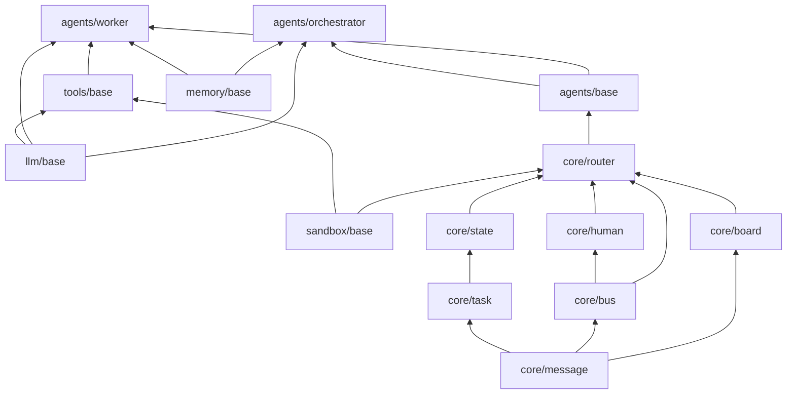

# 接口说明

> 配套代码：`mas/` 目录。设计依据：[design_decisions.md](design_decisions.md)（下文用"§"引用其章节）。
> 现状：**只有类型定义和方法签名**，方法体为 `raise NotImplementedError`。dataclass、枚举、频道工具函数、虚拟工具的 schema、`MockLLM`、`Settings` 已经可以直接使用。
> 规则：**接口改动需要 JIAN Yimin 和 LI Heyang 两人同意**，改完同步更新本文和 `tests/test_interfaces.py`。

---

## 1. 模块总览与负责人

| 文件 | 内容 | 负责人 | 设计依据 |
|---|---|---|---|
| `mas/core/message.py` | `Message`、`MsgType`、各类型 payload、频道函数 | JIAN Yimin | §3 |
| `mas/core/task.py` | `Task`、`TaskResult`、`TaskStatus`、`FailureMode` | JIAN Yimin | §4、§5、§3.1 |
| `mas/core/bus.py` | `MessageBus`、`InMemoryBus` | JIAN Yimin | §3 |
| `mas/core/router.py` | `Router`：中心化路由，纯代码 | JIAN Yimin | §2.1、§5、§7 |
| `mas/core/state.py` | `StateTable`：任务状态表 | JIAN Yimin | §4 |
| `mas/core/board.py` | `SessionBoard`：共享会话看板 | JIAN Yimin | §3.1 |
| `mas/core/human.py` | `HumanIO`、`CliHumanIO`、`HitlRequest`、`HitlKind` | JIAN Yimin | §7 |
| | `AutoResponder` | LI Heyang | §7 |
| `mas/agents/base.py` | `Agent` 基类 | JIAN Yimin | §3、§5、§7 |
| `mas/agents/orchestrator.py` | `Orchestrator` | JIAN Yimin | §2 |
| `mas/agents/virtual_tools.py` | `call_<agent>`、`decline`、`read_group`、`ask_human`、`finish` 的 schema | JIAN Yimin | §2.1、§2.2 |
| `mas/agents/worker.py` | `WorkerAgent`：ReAct 循环 | LI Heyang | §6 |
| `mas/agents/roles.py` | `RoleConfig`、三个角色的配置 | LI Heyang | §1 |
| `mas/memory/base.py` | `Experience`、`Memory`、`JsonlMemory` | JIAN Yimin | §8 |
| `mas/tools/base.py` | `Tool`、`ToolResult` | LI Heyang | §6 |
| `mas/sandbox/base.py` | `Sandbox`、`LocalSandbox`、`DockerSandbox`、`ExecResult` | LI Heyang | §9 |
| `mas/llm/base.py` | `LLMClient`、`LLMResponse`、`ToolCall`、`FunctionSpec` | LI Heyang | §11 |
| `mas/llm/deepseek.py` | `DeepSeekClient` | LI Heyang | §11 |
| `mas/llm/mock.py` | `MockLLM`（已实现） | 共用 | — |
| `mas/eval/harness.py` | `EvalCase`、`EvalRecord`、`run_suite`、`summarize` | LI Heyang | §10 |
| `mas/config.py` | `Settings`（已实现） | 共用 | 各节的上限与待定项 |

### 依赖方向



下层不依赖上层。LI Heyang 负责的 `llm`、`tools`、`sandbox` 都在最底层，不依赖总线和 agent，可以完全独立开发和测试。

---

## 2. 一次请求经过哪些接口

以人类在群里发"调研 X 并写个示例脚本推到 GitHub"为例：

```
CliHumanIO ──publish(CHAT)──▶ MessageBus ──▶ 所有成员收到
                                   │ observer（Router）
                                   ├──▶ Router 转发 → SessionBoard.on_message   （记录人类原话）
                                   ▼
Orchestrator.should_handle → handle_chat → run_root
   loop:
     LLMClient.chat(messages, function_specs)        ← call_<agent> 的描述里带 Memory.profile()
     LLMResponse.text  ──▶ SessionBoard.set_plan     （剩余步骤）
     LLMResponse.tool_calls（可能多个，并发执行）
        call_researcher ──▶ Router.dispatch(...)
                              ├─ 检查限制、StateTable.register、拷贝 files 到 inbox/
                              ├─ publish(TASK_ASSIGN @researcher)
                              └─ 等待 reply_to 对应的 TASK_RESULT
                                         ▲
WorkerAgent(researcher).on_message → handle_task(task)
   prompt = role.system_prompt + Memory.recall() + Agent.board_text(task) + goal
   loop: LLMClient.chat → Tool.run(sandbox, ...) → ToolResult
         需要授权 → Agent.ask_human → Router.request_human → HITL_REQUEST @human
         需要帮手 → Agent.call_agent → Router.dispatch（同一条路径）
   → TaskResult（artifacts / refs 根据 ToolResult 自动补全）→ publish(TASK_RESULT)
   → Memory.add(Experience)；失败时异步 reflect()
     finish ──▶ SessionBoard.finish_root，交付物拷到 output/，在群里回复
```

---

## 3. 各模块要点

### 3.1 消息 `mas/core/message.py`

`Message` 字段：

| 字段 | 说明 |
|---|---|
| `type` | `MsgType` |
| `sender` | agent_id 或 `"human"` |
| `channel` | `"group:main"` 或 `dm_channel(a, b)` |
| `content` | 显示在聊天里的文字，例如 `"@coder 写一个示例脚本"` |
| `payload` | 结构化数据，**必须能 JSON 序列化**，格式见下表 |
| `receiver` | 必须处理这条消息的成员；`None` 表示没有指定 |
| `mentions` | 正文里解析出的 @名字 |
| `reply_to` | `TASK_RESULT` 指向对应的 `TASK_ASSIGN`；`HITL_RESPONSE` 指向对应的 `HITL_REQUEST` |

payload 格式：

| MsgType | payload | 谁发 |
|---|---|---|
| `CHAT` | `{}`；`/cancel` 之后的 "Cancelled R1" 通知带 `{"cancelled_roots": ["R1", ...]}`（CLI 据此清掉那些 root 里还在等回答的请求） | 人类、agent |
| `TASK_ASSIGN` | `{"task": Task.to_dict()}` | Router |
| `TASK_RESULT` | `{"result": TaskResult.to_dict()}` | Agent 基类 |
| `HITL_REQUEST` | `{"request_id", "task_id", "root_id", "kind", "question", "options"}`（`task_id` 在 Orchestrator 澄清时为 `None`） | Router |
| `HITL_RESPONSE` | `{"request_id", "answer"}` | HumanIO |
| `STATUS` | `{"task_id", "status", "note", "public"}` | Agent 基类 |

频道函数：`dm_channel(a, b)` 与参数顺序无关（`dm:coder:human`）；`is_group(channel)`；`dm_members(channel)`。

### 3.2 任务 `mas/core/task.py`

- 每次 `call_<agent>` 产生一个 `Task`。字段里最关键的是：
  - `origin_channel`：根请求来自哪个频道，决定消息是否公开、HITL 在哪里弹出。再委派时由子任务**继承**。
  - `chain`：委派链，用于检查深度和循环。`depth` 属性等于委派层数。
  - `context`：只放这次调用特有的说明；会话的整体进展由看板提供。
  - `files`：交接的文件名，Router 会拷进执行者的 `inbox/`。
- `TaskResult`：`summary` 是 Worker 的最终回答；`artifacts`、`refs` 由代码根据工具调用记录补全；`open_issues` 进入看板的未办事项；被拒绝时 `declined=True` 并填 `suggest`。
- `FailureMode` 由 `TaskResult` 和评测共用，取值见 §10。
- `to_dict()` / `from_dict()` 已实现，测试保证能经过 JSON 来回转换。

### 3.3 总线 `mas/core/bus.py`

| 方法 | 约定 |
|---|---|
| `publish(msg)` | 先存入频道历史、通知所有 observer，再投递给频道的每个成员 |
| `subscribe(agent_id)` | 返回该成员的收件队列 |
| `join(agent_id, channel)` | 加入频道；私聊频道在首次发消息时自动加入双方 |
| `members(channel)` / `history(channel, limit)` | `history` 也是 `read_group` 工具的数据来源 |
| `add_observer(fn)` | `fn` 同步地看到所有频道的每条消息。Router、日志通过它获取消息，不需要加入每个私聊；会话看板不直接登记，由 Router 按会话转发 |

### 3.4 路由 `mas/core/router.py`（纯代码，不调 LLM）

所有委派，不论来自 Orchestrator 还是 Worker、群聊还是私聊，都走 `Router.dispatch()`：

1. 检查限制：深度、委派链里是否有循环、每个任务的委派次数、同一目标的重试次数。违反时直接返回失败的 `TaskResult`，不联系执行者。
2. 在 `StateTable` 登记；把 `files` 拷到执行者的 `inbox/`。
3. 发 `TASK_ASSIGN`：群聊任务发到 `group:main`，私聊任务发到 `dm_channel(requester, target)`。
4. 在 `subtask_timeout_s` 内等待对应的 `TASK_RESULT`，超时返回 `TIMEOUT` 失败；任务处于 `WAITING_HUMAN` 时不计时（等人类多久都行，`/cancel` 可随时终止）。**任务失败时从不抛异常。**

其他方法：`locate_file(name, requester, root_id)`（文件在哪个 workspace，Orchestrator 收集交付物时用）、`open_direct_task`（人类私聊或 @ 某个 agent 时登记任务）、`request_human`（HITL，编号 h1、h2……，弹在 `origin_channel`）、`board(session_id)`、`session_of(channel)`、`cancel_root`。

补充约定（第 2 步实现时定下的）：

- `Task.chain` 是**委派者**的链，不含执行者：Orchestrator 派出的任务 `chain == ["orchestrator"]`、`depth == 0`；coder 再委派给 researcher 的任务 `chain == ["orchestrator", "coder"]`、`depth == 1`。深度超过 `max_delegation_depth` 时拒绝；目标已在 `chain` 里（含请求者自己）时判为循环。
- 同一目标的重试：同一 root 下，同一 agent、同一目标（忽略大小写和多余空格）最多尝试 `1 + max_retries_same_goal` 次；被拒绝（declined）的不占次数。
- 被拒绝的调用（超限、未知 agent、文件找不到、root 已取消）返回 `success=False, failure_mode=TOOL_ERROR`，`error` 以 `refused:` 开头；**仍会在状态表里登记成一个 `FAILED` 任务**（方便 `/status` 和调试），不联系目标，也不占重试次数和委派次数。看板里不显示它们（避免 Worker 的 prompt 变长）。
- `files` 先在请求者自己的 sandbox 里找；找不到时，到本 root 内产出过该文件（出现在某个结果的 `artifacts`）的 agent 的 sandbox 里找。Orchestrator 没有 sandbox，所以走第二条路。
- 新增 `Router.new_root_id(session_id)`：返回 R1、R2……，**在所有会话里全局唯一**（状态表、`cancel_root`、重试计数都只用 root id 区分，所以不能让不同会话出现同一个 root id）。Orchestrator 开 root 时调用。
- 新增 `SessionBoard.add_task(task)`：`open_direct_task` 登记的直接任务不发 `TASK_ASSIGN`，由 Router 直接告诉看板。
- `session_of(channel)` 直接返回频道名，每个频道一个会话。
- `cancel_root` 之后，该 root 的新调用会被拒绝；等待中的 `dispatch` 返回 `error="cancelled"`，等待中的 `request_human`（包括 Orchestrator 的澄清）返回 `CANCELLED_ANSWER`（`mas.core.human`，值为 `"cancelled"`）。Router 无法停止正在运行的 agent，所以 **Worker 必须自己检查**：每一步 ReAct 开始前、执行 `requires_approval` 的工具前，调用 `self.is_cancelled(task)`；`ask_human` 返回 `CANCELLED_ANSWER` 时要当作中止，不能当成同意。
- `Router.request_human` 改成关键字参数：`request_human(*, session_id, root_id, origin_channel, requester, kind, question, options=None, task_id=None)`。Worker 照旧调 `Agent.ask_human(task, question, kind, options)`（签名不变，基类负责从 task 里取这些字段）；Orchestrator 澄清时没有 Task，传 `task_id=None`。**如果你的桩 Router 实现了 `request_human`，要改成这个签名。**
- 新增 `Agent.is_cancelled(task)`：该任务在状态表里是否已 `CANCELLED`。
- 新增 `Router.cancel_session(session_id)`：取消这个会话里所有还有未结束任务的 root，返回被取消的 root 列表。私聊里的 `/cancel` 用它（Orchestrator 管不到私聊任务）。
- Router 同时负责：根据 `STATUS` 更新状态表、把每条消息交给对应会话的看板。

### 3.5 状态表与看板

- `StateTable`：唯一的任务状态来源，只由 Router 写入；`/status`、看板、评测都从这里读。
  `status_text(session_id)`（`/status` 的回答）：当前 root（最近一个还有未结束任务的，否则最近一个）逐个列出任务；更早的 root 每个只占一行（"R1: 2 tasks, all done" / "done 1, failed 1, declined 1"），所以回答不会随聊天变长。
- `SessionBoard`：由 Router（bus 上的 observer）把本会话的消息转发给它，用代码更新，**不调 LLM**。`render()` 的压缩顺序和保留规则见 §3.1。每个会话一块看板，保存到 `data/sessions/<session_id>/board.json`。

### 3.6 人类端 `mas/core/human.py`

- `HumanIO` 是 id 为 `"human"` 的总线成员，有 `run / show / answer` 三个方法（子类实现），外加两个**共用的方法**（已实现，`AutoResponder` 直接用）：
  - `HumanIO.request_from(msg)`：把 `HITL_REQUEST` 消息还原成 `HitlRequest`（Orchestrator 澄清时 `task_id` 是空字符串）。
  - `handle_incoming(bus, msg)`：处理人类 inbox 里的一条消息——跳过人类自己发的；调用 `show`；如果是 `HITL_REQUEST`，就在后台调用 `answer`，并把答案作为 `HITL_RESPONSE`（`reply_to` 指向请求，发在请求所在的频道）发回。`run()` 其实就是"从 inbox 取消息 → `handle_incoming`"。后台处理，所以多个请求可以同时等待。
- `CliHumanIO`（已实现）：`run` 同时读输入和显示消息，直到 `/quit` 或输入结束。
  - 输入：直接打字 = 在群里发话（没有 `@` 谁由 Orchestrator 处理；恰好 `@` 一个 agent 时 `receiver` 就是它）；`/dm <agent> <内容>`（私聊，直接任务）；`/status`、`/cancel`（发给 Orchestrator，取消群里当前的请求）；`/cancel <agent>`（发到和那个 agent 的私聊，由它的 `handle_chat` 取消这个私聊里还在做的任务）；`/reply <编号> <回答>`（只有一个请求在等待时可省略编号）；`/help`；`/quit`。
  - 编号：群里的请求是 `h1`，私聊里的请求是 `coder:h1`；群里和私聊可以各有自己的 `h1`，写 `h1` 时群里的优先。
  - 显示：`CHAT`、`TASK_ASSIGN`、`TASK_RESULT`、`HITL_REQUEST`，以及 `public=True` 的 `STATUS`；私聊里的消息带 `(DM·coder)` 标签；人类自己发的、非公开的 `STATUS`、`HITL_RESPONSE` 不显示。
  - 收到 `{"cancelled_roots": [...]}` 的 "Cancelled R1" 通知后，CLI 清掉同一频道里属于这些 root 的待回答请求（Orchestrator 在步骤 5 里发这个通知；私聊里由 Agent 基类发）。
  - 输入：真实终端里用 `prompt_toolkit`（提示符固定在底部，消息从上面滚出来），没装或不是终端（管道、文件）时退回 `input()`。为了能测试，输入和输出也可以替换：`CliHumanIO(read_line=..., write=...)`。
- `AutoResponder`（LI Heyang）按 `HitlKind` 立即回复默认答案，并统计 `hitl_count`；`submit()` 供评测框架以人类身份下发任务。它只需实现 `show`（可以什么都不做）、`answer`、`run` 和 `submit`，`run` 里调用 `handle_incoming` 即可。

### 3.7 Agent 基类 `mas/agents/base.py`

子类只需实现 `handle_task`（以及需要时重写 `handle_chat`）。下面这些服务由基类提供，ReAct 循环不需要直接操作总线：

| 方法 | 作用 |
|---|---|
| `run()` | 订阅自己的 inbox，不停取消息；每条该自己处理的消息开一个独立的 asyncio 任务，所以一个 agent 可以同时做多个任务。`run()` 被取消时，在途的处理也一并取消（已实现） |
| `should_handle(msg)` | 只处理 `receiver` 是自己或 @ 到自己的消息（已实现） |
| `on_message(msg)` | `TASK_ASSIGN` → 发"收到"的公开 `STATUS` → `handle_task` → 发 `TASK_RESULT`（`reply_to` 是那条 `TASK_ASSIGN`，发在 `task.channel` 里）；人类发来的 `CHAT` → `handle_chat`；其他消息忽略。`handle_task` 里的任何异常都转成 `CRASH` 结果，`handle_chat` 里的异常变成聊天里的一行报错，系统不会崩（已实现） |
| `handle_chat(msg)` | **默认实现（Worker 直接用）**：把人类的私聊或 @ 当作直接任务——`Router.open_direct_task` 登记、跑 `handle_task`、把 `TASK_RESULT` 发回给人类；`/cancel` 取消这个私聊（或 @ 会话）里还没结束的任务并发"已取消"通知；其他以 `/` 开头的命令忽略。想"只回答问题不建任务"的子类可以重写，其余情况请调用 `super().handle_chat(msg)`（已实现） |
| `report_status(task, status, note, public)` | 在 `task.channel` 发 `STATUS`，Router 据此更新状态表。`public=True` 才会在聊天里显示 `note`，只用于"收到"这类节点；否则消息没有正文（已实现） |
| `ask_human(task, question, kind, options)` | 转给 `Router.request_human`；被 `/cancel` 时返回 `CANCELLED_ANSWER`（已实现） |
| `is_cancelled(task)` | 任务是否已被 `/cancel`；Worker 每步前都要检查（已实现） |
| `call_agent(task, target, goal, context, files)` | 再委派，转给 `Router.dispatch`（已实现） |
| `board_text(task)` | 当前会话看板的文本（已实现） |

基类在发出 `TASK_RESULT` 之前还会做三件事，Worker 不必操心：把 `result.task_id` 改成真实任务的 id；把 `summary` 截断到 `result_summary_max_chars`（默认 1500）；`duration` 为 0 时补上耗时。任务在开始前就已被 `/cancel` 的话，不会调用 `handle_task`，直接返回 `error="cancelled"`。

新增 `Task.channel`：这个任务的 `TASK_ASSIGN`、`STATUS`、`TASK_RESULT` 所在的频道（群聊任务是 `group:main`，否则是请求者和执行者的私聊）。

### 3.8 虚拟工具 `mas/agents/virtual_tools.py`（schema 已实现）

LLM 能看到、但不属于 `Tool` 子类的工具：

| 工具 | 谁能用 | 由谁处理 |
|---|---|---|
| `call_<agent>(goal, context, files)` | Orchestrator；Worker（不含调用自己） | `Router.dispatch` |
| `decline(reason, suggest)` | Worker，仅限第一步 | Worker 直接返回 `declined` 结果 |
| `read_group(limit)` | Worker | `MessageBus.history` |
| `ask_human(question, options)` | Orchestrator | `Router.request_human`（澄清） |
| `finish(summary, deliverables)` | Orchestrator | 结束根任务 |

`call_agent_spec(role, profile)` 会把记忆生成的能力档案拼进工具描述里；`target_of("call_coder") == "coder"`。

### 3.9 Worker `mas/agents/worker.py`、`roles.py`

- `WorkerAgent(role, bus, router, settings, llm, tools, sandbox, memory)`。
- `handle_task` 的步骤写在 docstring 里，对应 §6：召回记忆、注入看板、最多 12 步、需要授权的工具先请求人类批准、同一工具连续失败 2 次时求助、补全 `artifacts/refs`、写入记忆、失败时异步 `reflect()`。
- `function_specs(task)`：真实工具 + 其他 agent 的 `call_<agent>` + `decline` + `read_group`。
- `RoleConfig.capability` 是 Orchestrator 看到的能力描述；`system_prompt` 还没写（`TODO(LI Heyang)`）。

### 3.10 Orchestrator `mas/agents/orchestrator.py`

- **该处理哪些消息**（`should_handle`）：发给它的（`receiver` 是 orchestrator，或 @ 到它），以及群里人类发的、没有 @ 任何人的消息（D7）。@ 了 agent 的消息只有那个 agent 处理。人类私聊 `orchestrator` 时，它在那个私聊会话里处理。
- `handle_chat`：
  - `/status`：直接读状态表回答，不调 LLM（输出规则见 §3.5）。如果有一个请求正在处理、还没派出任务，会先写一行"R2 is being worked on; no task has been sent out yet."。
  - `/cancel`：取消这个会话里所有未结束的任务和正在运行的请求，打断它的循环，发 "Cancelled R1" 通知（payload 带 `cancelled_roots`，CLI 据此清掉残留的请求）；没有进行中的任务时回"没有进行中的任务可以取消"。
  - 其他消息：同一个会话里**已有请求在运行**时，当作插话，下一轮以 "(Human addition) ..." 追加给 LLM（看板也会记下）；否则开新 root（`Router.new_root_id`）并 `run_root`。
- `run_root` 的循环，对应 §2.1：
  - 第一条 user 消息是 "Human request: ..." 加会话看板文字（早先的 root 在里面各占一行，所以"把刚才的纪要翻译成英文"能找到文件）。
  - 每轮 `llm.chat(messages, function_specs)`；`resp.text` 作为剩余计划（截到 200 字）写进看板。
  - 一轮中的多个 `call_<agent>` 经 `Router.dispatch` 执行：**不同 agent 之间并行，同一个 agent 的多个调用按顺序一个接一个**（它们共用那个 agent 的 workspace，同时跑会互相覆盖文件或同时 commit）；回给 LLM 的是 JSON：`success`、`summary`、`artifacts`、`refs`、`open_issues`、`error`；被拒绝时是 `declined`、`reason`、`suggest`。
  - `ask_human` 走 `Router.request_human`（澄清，`task_id=None`），回答作为 `{"answer": ...}` 回给 LLM。
  - `finish(summary, deliverables)` 必须**单独**调用（和别的调用一起发会被拒绝并提示）。交付物从产出它的 agent 的 workspace（`Router.locate_file`）拷到 `data/output/<root_id>-<启动时间>/`（如 `R1-20261109-153012`；root 编号每次启动都从 R1 重来，加上时间才不会和上次的文件混在一起，同一秒启动的会再加 `-2`）。完整路径在最终回复的 `payload["output_dir"]` 里。
  - 没有任何工具调用但有文字：当作最终回答；既没有工具调用也没有文字：提醒一次，占一轮。
  - 轮数用完（`max_orchestrator_rounds`，默认 8）：用代码拼一段 "Done: ... Not done: ..." 的汇报，失败模式 `max_rounds`，已成功的产物也保留。`LLMError`：汇报失败，失败模式 `crash`。
  - 取消时看板上该 root 标为 "Cancelled"，不发最终回复。
- **最终回复**是群里（或那个私聊里）一条 `CHAT`，`receiver` 是 human，文字是 `@human <summary>` 加交付物清单；`payload`：`{"final": True, "root_id", "success", "rounds", "failure_mode", "deliverables", "output_dir"}`。评测框架等它即可。`success` 的意思是"LLM 调用了 finish"，结果对不对由评测的检查器判断。
- `Orchestrator.outcomes[root_id]`：`RootOutcome(root_id, success, rounds, failure_mode, summary, deliverables, output_dir, duration)`，评测框架可以直接读。
- 能力档案（`function_specs`）：每个根任务开始时读一次各 agent 的 `memory.profile()` 拼进 `call_<agent>` 的描述；某个 agent 没有记忆或读失败，就不带档案。

### 3.11 工具 `mas/tools/base.py`

- `Tool` 的属性：`name`、`description`、`parameters`（JSON Schema）、`requires_approval`。
- `async run(sandbox, **kwargs) -> ToolResult`：预期内的失败返回 `ok=False`，**不要抛异常**。
- `ToolResult.files_written` 和 `refs` 会被汇总进 `TaskResult`，所以写文件、git 提交的工具必须填写。
- `spec()` 已实现，返回 `FunctionSpec`。
- 角色配置里用到的工具名：`web_search`、`fetch_url`、`read_file`、`write_file`、`delete_file`、`list_files`、`run_python`、`git`。

### 3.12 沙箱 `mas/sandbox/base.py`

- 所有路径都相对于 agent 的 workspace 根目录；`resolve()` 发现越界时抛 `PermissionError`。
- `exec(cmd, timeout, env)` 不会因返回码非零或超时而抛异常，结果统一用 `ExecResult` 表示。
- `import_file(src, name)` 只有 Router 调用，用于把上游产物拷进 `inbox/`。
- `DockerSandbox` 继承 `LocalSandbox` 的文件操作（workspace 用 bind mount 挂载），只重写 `exec`，在常驻容器里执行。用哪个由 `Settings.sandbox_backend` 决定。

### 3.13 记忆 `mas/memory/base.py`

- `JsonlMemory`（已实现）：每个 agent 一个文件 `data/memory/<agent_id>.jsonl`，一条 `Experience` 一行（UTF-8，中文不转义）。`JsonlMemory.for_agent(settings.memory_dir, agent_id)` 给出路径。不调 LLM。
  - `add(exp)`：追加一行。同一个 `task_id` 写了两次，**后写的算数**（读的时候取最后一条，并算作最新），所以 Worker 可以先记失败、等异步反思出教训后再 `add` 一次带教训的。坏掉的行读的时候跳过并记一条警告，不会让整个记忆读不出来。
  - `recall(query, k)`：按关键词重合度排序，返回最多 k 条。关键词：英文单词（小写，去掉 a/the 之类的停用词）和中文的相邻两字。目标和标签里的词算 2 分，摘要和教训里的算 1 分；**有教训的再加 1 分**（教训正是召回要给 Worker 看的）；同分新的在前；一个词都不重合的不返回。
  - `profile(max_chars)`：能力档案，形如 `Recent performance: code 8/10 succeeded, git 3/3 succeeded. Known weak spots: pip install times out; pages that need JS rendering fail.`。统计的是**最近 20 条**（`PROFILE_WINDOW`）里每个标签的成功数/总数（一条有多个标签就各算一次，没有标签算 `other`），按出现次数从多到少排；"Known weak spots" 是最近几次失败的教训（最多 3 条，重复的只写一次，成功记录里的教训忽略，放不下的跳过）。没有任何记录时返回空字符串；长度绝不超过 `max_chars`。
  - `all()`：按时间从旧到新返回全部记录（评测或调试用）。
  - `clear()`：忘掉一切（删掉文件，没有文件也不报错）。评测框架要做"从空记忆开始"的对比实验时一行就能重置。只清这个 agent 自己的。
- `tags_for_tools(tool_names, artifacts)`：Worker 打标签用的现成函数：`run_python` → `code`、`git` → `git`、`web_search`/`fetch_url` → `search`、读写删列文件 → `file`、写了 `.md`/`.txt` → `doc`，按第一次出现的顺序。不认识的工具不加标签。（对应评测的五类：code / doc / search / file / git。）
- `Experience.tags` 根据用到的工具自动打标签（例如 `["code", "git"]`），不调 LLM。
- `recall(query, k)` → 注入 Worker 的 prompt；`profile(max_chars)` → 拼进 `call_<agent>` 的描述（Orchestrator 每个根任务开始时读一次）。两者都不调 LLM。

### 3.14 LLM `mas/llm/`

- 消息使用 OpenAI 格式（`{"role": ..., "content": ...}`），DeepSeek API 可以直接接受。
- `chat(messages, tools, temperature) -> LLMResponse`：内部负责重试、退避和 tool call JSON 修复；彻底失败时才抛 `LLMError`。
- `LLMResponse.tool_calls` 是列表，可能包含多个调用，调用方应并发执行。`text` 可以和 tool call 同时存在（Orchestrator 用它写剩余计划）。
- `MockLLM(script=[...], responder=fn)` 已实现：按顺序返回预设的响应，用完后调用 `responder`；`calls` 记录每次调用，方便断言。

### 3.15 评测 `mas/eval/harness.py`

- `EvalCase(id, prompt, category, checker)`：`checker(output_dir) -> bool`；为 `None` 时以"无失败完成"作为成功标准。
- `EvalRecord` 记录：是否成功、子任务总数和完成数、耗时、Orchestrator 轮数、HITL 次数、失败模式。
- 每个用例使用新会话，只有记忆跨用例保留（§10）。

### 3.16 配置 `mas/config.py`（已实现）

所有上限和待定项都是 `Settings` 的字段，确定后只改配置，不改接口：

| 字段 | 默认值 | 对应 |
|---|---|---|
| `max_orchestrator_rounds` / `max_worker_steps` | 8 / 12 | D11 |
| `subtask_timeout_s` | 180 | 待确认 |
| `max_delegation_depth` / `max_delegations_per_task` / `max_retries_same_goal` | 2 / 2 / 2 | §5、D10 |
| `result_summary_max_chars` / `board_max_chars` / `tool_output_max_chars` | 1500 / 2000 / 4000 | §2.1、§3.1、§6 |
| `memory_recall_k` / `profile_max_chars` | 3 / 300 | §8、§2.3 |
| `sandbox_backend` | `"local"` | 待确认 |
| `deepseek_model` / `orchestrator_model` | `deepseek-chat` / 空（与前者相同） | 待验证 |
| `auto_hitl` | `False` | 评测时设为 `True` |

`Settings.from_env(**overrides)` 读取 `.env` 中的变量（见 `.env.example`），遇到未知字段直接报错。运行时数据统一放在 `data/` 下（已在 `.gitignore` 中）。

### 3.17 组装与入口 `mas/app.py`、`mas/demo.py`、`mas/__main__.py`（已实现）

- `build_system(settings, llm, human, *, roles=None, worker_factory=..., sandbox_factory=...) -> System`：唯一知道各个零件怎么接在一起的地方。创建 `InMemoryBus`、`StateTable`，每个角色一个 workspace（`settings.workspaces_dir/<agent_id>`）和一份记忆（`JsonlMemory.for_agent`），然后是 `Router`、`Orchestrator` 和各个 Worker，最后让 human、orchestrator 和所有 Worker 加入 `group:main`（`Router` 要求被派活的 agent 在群里）。
- `System`：`start()`（启动 Orchestrator 和各 Worker 的循环）、`stop()`、`run()`（启动全部，跑 human 一侧，直到 `/quit`，然后停掉 agent）；字段 `bus / state / router / orchestrator / workers / memories / sandboxes / human`。评测框架可以自己 `build_system(..., human=AutoResponder())` 再 `start()`。
- **接口点（LI Heyang 要接的地方）**，每个都有默认值：
  - `build_tools(role, settings) -> list[Tool]`：返回 `role.tool_names` 对应的真实工具。**现在返回空列表**，写好工具后在这里接上。
  - `default_worker_factory`：`WorkerAgent(role, bus, router, settings, llm, build_tools(...), sandbox, memory)`；想换实现就传 `worker_factory=`（参数是 `RoleConfig` 和 `WorkerParts(bus, router, settings, llm, sandbox, memory)`）。
  - `default_sandbox_factory`：按 `settings.sandbox_backend` 用 `LocalSandbox` 或 `DockerSandbox`。
  - `make_llm(settings)`：按 `llm_provider` 建 `DeepSeekClient`；没有 `DEEPSEEK_API_KEY` 时直接退出并告诉你怎么办。`make_human(settings)`：`auto_hitl` 为真用 `AutoResponder`，否则用 `CliHumanIO`。
- `python -m mas`：真实系统（需要 LI 的 `WorkerAgent`、工具、`DeepSeekClient`）。选项：`--data-dir`、`-v`。**日志写到 `<data-dir>/mas.log`**（INFO 及以上，出内部错误时有完整堆栈），不打到屏幕，免得堆栈冲乱聊天界面；`-v` 才同时打到屏幕。日志文件放在 `demo/` 外面，所以清空 demo 数据不会删掉它；日志文件写不了时退回屏幕。会读取 `.env`（装了 python-dotenv 的话）。
- `python -m mas --demo`：**不需要 API key，也不需要 LI 的部分**。用真实的 bus / Router / 状态表 / 记忆 / Orchestrator / 命令行，换上三个替身：`demo_brain`（用规则决策的"LLM"，交给 `MockLLM(responder=...)`）、`DemoWorker`（假装工作三步，写一个文件，会拒绝自己做不了的事、做危险的事前问人类、被取消就停下、开始前召回教训、结束时记一条经验）、`DemoSandbox`（只能读写文件）。数据放在 `<data-dir>/demo/`，**每次启动都会先清空**（想保留上次的记忆和文件加 `--keep`）；`--delay` 调每一步的耗时。试试：`write a python script and a document`、`run the tests`（writer 拒绝，改派给 coder）、`write a script and push it`（要你批准，`/reply yes`），在同一次运行里，拒绝一次之后再做同样的事，会看到它记得上次的教训。
- 命令行输出会立即 flush，所以通过管道（`| tee`、子进程）也是实时的。

---

## 4. 全局约定

1. **全部使用 async**：涉及 I/O 的方法都是 `async`；一个 agent 可以同时处理多个任务。
2. **失败用返回值表示，不抛异常**：工具返回 `ToolResult(ok=False)`，任务返回 `TaskResult(success=False, failure_mode=...)`。只有程序 bug 才会抛异常，并在 `Agent.on_message` 里被兜底为 `CRASH`。
3. **只在以下几处调 LLM**：Orchestrator 的每一轮、Worker 的每一步、失败后的异步反思。路由、看板、状态表、记忆召回、能力档案、"收到"之类的通知，都不调 LLM。
4. **payload 必须能 JSON 序列化**：`Task` 和 `TaskResult` 通过 `to_dict()` 放进 payload。
5. **代码中的 agent_id 固定为**：`orchestrator`、`researcher`、`coder`、`writer`、`human`。

---

## 5. 如何并行开发

- **LI Heyang**：`llm`、`tools`、`sandbox` 不依赖总线，可以直接写单元测试。`WorkerAgent.handle_task` 可以用 `MockLLM` 加一个桩 Router（只需实现 `dispatch`、`request_human`、`board`）单独测试（桩的 `request_human` 用上面的关键字参数签名；或者在测试里直接替换 `Agent.ask_human`）。
- **JIAN Yimin**：`bus`、`router`、`state`、`board`、`orchestrator` 可以用 `MockLLM` 加一个桩 Worker（`handle_task` 直接返回固定的 `TaskResult`）打通整个流程。
- **联调**：两边都完成后，把桩替换成真实实现，用 `MockLLM` 先跑通，再换成 `DeepSeekClient`。
- 运行测试：`python3 -m unittest`（安装 dev 依赖后也可以用 `pytest`）。
