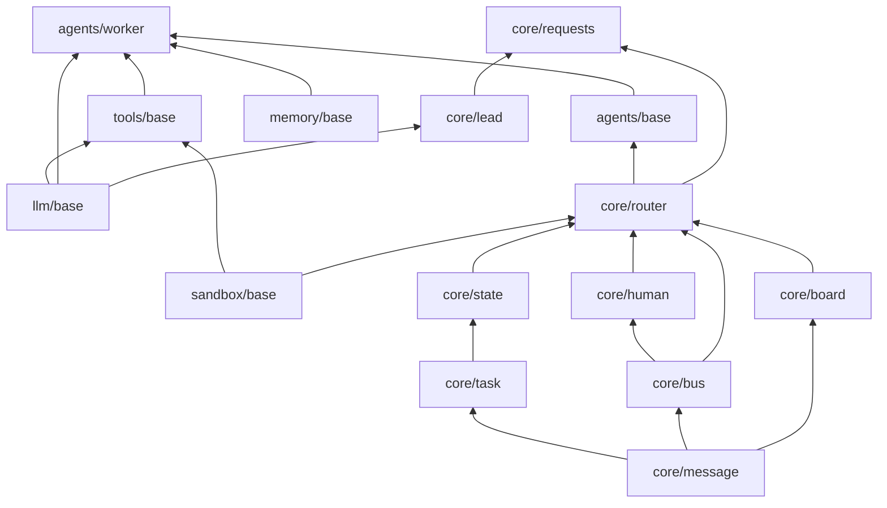

# 接口说明

> 配套代码：`mas/` 目录。设计依据：[design_decisions.md](design_decisions.md)（下文用"§"引用其章节）。
> 现状：通信、路由、状态、看板、Agent 基类、请求层（`RequestTracker`）、牵头者选择、团队与场景加载、对话导出、记忆、系统组装、通用 Worker（含队友委派与向人提问）、LocalSandbox、八个工具（文件、Python、网络、Git）、HKGAI 客户端和 AutoResponder 已实现。Docker 执行和评测框架（`mas/eval/harness.py`）仍待完成。2026-11-18 起不再有 Orchestrator agent，见 D18 和 §3.10。
> 规则：**接口改动需要 JIAN Yimin 和 LI Heyang 两人同意**，改完同步更新本文和 `tests/test_interfaces.py`。

---

## 1. 模块总览与负责人

| 文件 | 内容 | 负责人 | 设计依据 |
|---|---|---|---|
| `mas/core/message.py` | `Message`、`MsgType`、各类型 payload、频道函数 | JIAN Yimin | §3 |
| `mas/core/task.py` | `Task`、`TaskResult`、`TaskStatus`、`FailureMode` | JIAN Yimin | §4、§5、§3.1 |
| `mas/core/bus.py` | `MessageBus`、`InMemoryBus` | JIAN Yimin | §3 |
| `mas/core/router.py` | `Router`：中心化路由，纯代码 | JIAN Yimin | §2.1、§5、§7 |
| `mas/core/state.py` | `StateTable`：任务状态表 | JIAN Yimin | §4 |
| `mas/core/board.py` | `SessionBoard`：共享会话看板 | JIAN Yimin | §3.1 |
| `mas/core/human.py` | `HumanIO`、`CliHumanIO`、`HitlRequest`、`HitlKind` | JIAN Yimin | §7 |
| | `AutoResponder` | LI Heyang | §7 |
| `mas/agents/base.py` | `Agent` 基类 | JIAN Yimin | §3、§5、§7 |
| `mas/core/requests.py` | `RequestTracker`：请求层（不是 agent，不调 LLM） | JIAN Yimin | D18 |
| `mas/core/lead.py` | `LeadSelector`：选牵头者 | JIAN Yimin | D18 |
| `mas/core/transcript.py` | `Transcript`：对话导出 | JIAN Yimin | — |
| `mas/team.py`、`mas/scenario.py` | 读团队文件、读场景并依次发任务 | JIAN Yimin | — |
| `mas/agents/virtual_tools.py` | `call_<agent>`、`decline`、`read_group`、`ask_human` 的 schema | JIAN Yimin | §2.1、§2.2 |
| `mas/agents/worker.py` | `WorkerAgent`：ReAct 循环 | LI Heyang | §6 |
| `mas/agents/roles.py` | `RoleConfig`、演示与测试用的示例团队 `ROLES` | LI Heyang | §1 |
| `mas/memory/base.py` | `Experience`、`Memory`、`JsonlMemory` | JIAN Yimin | §8 |
| `mas/tools/base.py` | `Tool`、`ToolResult` | LI Heyang | §6 |
| `mas/sandbox/base.py` | `Sandbox`、`LocalSandbox`、`DockerSandbox`、`ExecResult` | LI Heyang | §9 |
| `mas/llm/base.py` | `LLMClient`、`LLMResponse`、`ToolCall`、`FunctionSpec` | LI Heyang | §11 |
| `mas/llm/hkgai.py` | `HKGAIClient`（课程网关，默认） | LI Heyang | §11 |
| `mas/llm/mock.py` | `MockLLM`（已实现） | 共用 | — |
| `mas/eval/harness.py` | `EvalCase`、`EvalRecord`、`run_suite`、`summarize` | LI Heyang | §10 |
| `mas/config.py` | `Settings`（已实现） | 共用 | 各节的上限与待定项 |

### 依赖方向



下层不依赖上层。LI Heyang 负责的 `llm`、`tools`、`sandbox` 都在最底层，不依赖总线和 agent，可以完全独立开发和测试。

---

## 2. 一次请求经过哪些接口

以人类在群里发"调研 X 并写个示例脚本推到 GitHub"为例：

```
CliHumanIO ──publish(CHAT)──▶ MessageBus ──▶ 所有成员收到
                                   │ observer
                                   ├──▶ Router → SessionBoard.on_message          （记录人类原话）
                                   ├──▶ Transcript                                 （写入对话记录）
                                   └──▶ RequestTracker.is_request → handle_chat → run_request
                                          LeadSelector.choose            （一次 LLM 调用；缓存；失败退回第一位成员）
                                          Router.dispatch(requester="orchestrator", target=牵头者, goal=人类原话)
                                                     │
WorkerAgent(牵头者).on_message → handle_task(task)   ▼   （task.parent_id is None：它牵头）
   prompt = role.system_prompt + 团队与牵头说明 + Memory.recall() + Agent.board_text(task) + goal
   loop: LLMClient.chat(messages, function_specs)   ← call_<队友> 的描述里带队友的 Memory.profile()
         工具调用 ──▶ Tool.run(sandbox, ...) → ToolResult
         需要授权 ──▶ Agent.ask_human(APPROVAL) → Router.request_human → HITL_REQUEST @human
         ask_human ──▶ Router.request_human（CLARIFY）
         call_<队友> ──▶ Router.dispatch（同一条路径）
                            ├─ 检查限制、StateTable.register、拷贝 files 到 inbox/
                            ├─ publish(TASK_ASSIGN @队友)
                            └─ 等待 reply_to 对应的 TASK_RESULT ◀── WorkerAgent(队友) 执行同样的循环
   → TaskResult（artifacts / refs 根据 ToolResult 自动补全）→ publish(TASK_RESULT)
   → Memory.add(Experience)；失败时异步 reflect()
RequestTracker 收到牵头者的结果：收集交付物到 data/output/，记录 RootOutcome，
   以牵头者的名义发最终回复（payload final=True）。取消的请求没有最终回复。
```

---

## 3. 各模块要点

### 3.1 消息 `mas/core/message.py`

`Message` 字段：

| 字段 | 说明 |
|---|---|
| `type` | `MsgType` |
| `sender` | agent_id 或 `"human"` |
| `channel` | `"group:main"` 或 `dm_channel(a, b)` |
| `content` | 显示在聊天里的文字，例如 `"@coder 写一个示例脚本"` |
| `payload` | 结构化数据，**必须能 JSON 序列化**，格式见下表 |
| `receiver` | 必须处理这条消息的成员；`None` 表示没有指定 |
| `mentions` | 正文里解析出的 @名字 |
| `reply_to` | `TASK_RESULT` 指向对应的 `TASK_ASSIGN`；`HITL_RESPONSE` 指向对应的 `HITL_REQUEST` |

payload 格式：

| MsgType | payload | 谁发 |
|---|---|---|
| `CHAT` | `{}`；`/cancel` 之后的 "Cancelled R1" 通知带 `{"cancelled_roots": ["R1", ...]}`（CLI 据此清掉那些 root 里还在等回答的请求） | 人类、agent |
| `TASK_ASSIGN` | `{"task": Task.to_dict()}` | Router |
| `TASK_RESULT` | `{"result": TaskResult.to_dict()}` | Agent 基类 |
| `HITL_REQUEST` | `{"request_id", "task_id", "root_id", "kind", "question", "options"}`（`task_id` 在请求层澄清时为 `None`） | Router |
| `HITL_RESPONSE` | `{"request_id", "answer"}` | HumanIO |
| `STATUS` | `{"task_id", "status", "note", "public"}` | Agent 基类 |

频道函数：`dm_channel(a, b)` 与参数顺序无关（`dm:coder:human`）；`is_group(channel)`；`dm_members(channel)`。

### 3.2 任务 `mas/core/task.py`

- 每次 `call_<agent>` 产生一个 `Task`。字段里最关键的是：
  - `origin_channel`：根请求来自哪个频道，决定消息是否公开、HITL 在哪里弹出。再委派时由子任务**继承**。
  - `chain`：委派链，用于检查深度和循环。`depth` 属性等于委派层数。
  - `context`：只放这次调用特有的说明；会话的整体进展由看板提供。
  - `files`：交接的文件名，Router 会拷进执行者的 `inbox/`。
- `TaskResult`：`summary` 是 Worker 的最终回答；`artifacts`、`refs` 由代码根据工具调用记录补全；`open_issues` 进入看板的未办事项；被拒绝时 `declined=True` 并填 `suggest`。
- `FailureMode` 由 `TaskResult` 和评测共用，取值见 §10。
- `to_dict()` / `from_dict()` 已实现，测试保证能经过 JSON 来回转换。

### 3.3 总线 `mas/core/bus.py`

| 方法 | 约定 |
|---|---|
| `publish(msg)` | 先存入频道历史、通知所有 observer，再投递给频道的每个成员 |
| `subscribe(agent_id)` | 返回该成员的收件队列 |
| `join(agent_id, channel)` | 加入频道；私聊频道在首次发消息时自动加入双方 |
| `members(channel)` / `history(channel, limit)` | `history` 也是 `read_group` 工具的数据来源 |
| `add_observer(fn)` | `fn` 同步地看到所有频道的每条消息。Router、日志通过它获取消息，不需要加入每个私聊；会话看板不直接登记，由 Router 按会话转发 |

### 3.4 路由 `mas/core/router.py`（纯代码，不调 LLM）

所有委派，不论来自请求层（把请求交给牵头者）还是 Worker、群聊还是私聊，都走 `Router.dispatch(..., timeout=None)`（`timeout` 默认取 `subtask_timeout_s`，请求层给牵头者传 `lead_timeout_s`）：

1. 检查限制：深度、委派链里是否有循环、每个任务的委派次数、同一目标的重试次数。违反时直接返回失败的 `TaskResult`，不联系执行者。
2. 在 `StateTable` 登记；把 `files` 拷到执行者的 `inbox/`。
3. 发 `TASK_ASSIGN`：群聊任务发到 `group:main`，私聊任务发到 `dm_channel(requester, target)`。
4. 在 `subtask_timeout_s` 的累计执行时间内等待对应的 `TASK_RESULT`，超时返回 `TIMEOUT` 失败；精确扣除每段 `WAITING_HUMAN` 时间（等人类多久都行，`/cancel` 可随时终止），答复后继续使用剩余预算，不重置全部时间。**任务失败时从不抛异常。**

任务终态以 `StateTable` 已保存的结果为准：Agent 跳过超时后才收到的任务，晚返回的成功不能覆盖原来的 `TIMEOUT` 或改变看板状态。已结束、未知任务或已取消 root 不再创建 HITL 请求；审批创建前执行预算已耗尽时也先结束为 `TIMEOUT`。

其他方法：`locate_file(name, requester, root_id, session_id=None)`（文件在哪个 workspace）、`root_artifacts(root_id)`（这个 root 里成功任务写的文件，`(agent, 文件)` 列表，请求层收集交付物用）、`open_direct_task`（人类私聊或 @ 某个 agent 时登记任务）、`request_human`（HITL，编号 h1、h2……，弹在 `origin_channel`）、`board(session_id)`、`session_of(channel)`、`cancel_root`。

补充约定（第 2 步实现时定下的）：

- `Task.chain` 是**委派者**的链，不含执行者：请求层交给牵头者的任务 `chain == ["orchestrator"]`、`depth == 0`（`"orchestrator"` 只是请求层的身份，不是 agent）；牵头者 `coder` 再委派给 `researcher` 的任务 `chain == ["orchestrator", "coder"]`、`depth == 1`。深度超过 `max_delegation_depth` 时拒绝；目标已在 `chain` 里（含请求者自己）时判为循环。
- 同一目标的重试：同一 root 下，同一 agent、同一目标（忽略大小写和多余空格）最多尝试 `1 + max_retries_same_goal` 次；被拒绝（declined）的不占次数。
- 被拒绝的调用（超限、未知 agent、文件找不到、root 已取消）返回 `success=False, failure_mode=TOOL_ERROR`，`error` 以 `refused:` 开头；**仍会在状态表里登记成一个 `FAILED` 任务**（方便 `/status` 和调试），不联系目标，也不占重试次数和委派次数。看板里不显示它们（避免 Worker 的 prompt 变长）。
- `files` 先在请求者自己的 sandbox 里找；找不到时，到产出过该文件（出现在某个结果的 `artifacts`）的 agent 的 sandbox 里找，先找本 root，再找**同一会话里更早的 root**（所以 Task 2 能用 Task 1 的文件，而更晚的 root 不会反向泄露）。
- 新增 `Router.new_root_id(session_id)`：返回 R1、R2……，**在所有会话里全局唯一**（状态表、`cancel_root`、重试计数都只用 root id 区分，所以不能让不同会话出现同一个 root id）。请求层开 root 时调用。
- 新增 `SessionBoard.add_task(task)`：`open_direct_task` 登记的直接任务不发 `TASK_ASSIGN`，由 Router 直接告诉看板。
- `session_of(channel)` 直接返回频道名，每个频道一个会话。
- `cancel_root` 之后，该 root 的新调用会被拒绝；等待中的 `dispatch` 返回 `error="cancelled"`，等待中的 `request_human`（包括请求层的澄清）返回 `CANCELLED_ANSWER`（`mas.core.human`，值为 `"cancelled"`）。Router 无法停止正在运行的 agent，所以 **Worker 必须自己检查**：每一步 ReAct 开始前、执行 `requires_approval` 的工具前，调用 `self.is_cancelled(task)`；`ask_human` 返回 `CANCELLED_ANSWER` 时要当作中止，不能当成同意。
- `Router.request_human` 改成关键字参数：`request_human(*, session_id, root_id, origin_channel, requester, kind, question, options=None, task_id=None)`。Worker 照旧调 `Agent.ask_human(task, question, kind, options)`（签名不变，基类负责从 task 里取这些字段）；请求层澄清时没有 Task，传 `task_id=None`。**如果你的桩 Router 实现了 `request_human`，要改成这个签名。**
- 新增 `Agent.is_cancelled(task)`：该任务在状态表里是否已 `CANCELLED`。
- 新增 `Router.cancel_session(session_id)`：取消这个会话里所有还有未结束任务的 root，返回被取消的 root 列表。私聊里的 `/cancel` 用它（请求层管不到私聊任务）。
- Router 同时负责：根据 `STATUS` 更新状态表、把每条消息交给对应会话的看板。

### 3.5 状态表与看板

- `StateTable`：唯一的任务状态来源，只由 Router 写入；`/status`、看板、评测都从这里读。
  `status_text(session_id)`（`/status` 的回答）：当前 root（最近一个还有未结束任务的，否则最近一个）逐个列出任务；更早的 root 每个只占一行（"R1: 2 tasks, all done" / "done 1, failed 1, declined 1"），所以回答不会随聊天变长。
- `SessionBoard`：由 Router（bus 上的 observer）把本会话的消息转发给它，用代码更新，**不调 LLM**。`render()` 的压缩顺序和保留规则见 §3.1。每个会话一块看板，保存到 `data/sessions/<session_id>/board.json`。

### 3.6 人类端 `mas/core/human.py`

- `HumanIO` 是 id 为 `"human"` 的总线成员，有 `run / show / answer` 三个方法（子类实现），外加两个**共用的方法**（已实现，`AutoResponder` 直接用）：
  - `HumanIO.request_from(msg)`：把 `HITL_REQUEST` 消息还原成 `HitlRequest`（请求层澄清时 `task_id` 是空字符串）。
  - `handle_incoming(bus, msg)`：处理人类 inbox 里的一条消息——跳过人类自己发的；调用 `show`；如果是 `HITL_REQUEST`，就在后台调用 `answer`，并把答案作为 `HITL_RESPONSE`（`reply_to` 指向请求，发在请求所在的频道）发回。`run()` 其实就是"从 inbox 取消息 → `handle_incoming`"。后台处理，所以多个请求可以同时等待。
- `CliHumanIO`（已实现）：`run` 同时读输入和显示消息，直到 `/quit` 或输入结束。
  - 输入：直接打字 = 在群里发话（没有 `@` 谁由请求层（`RequestTracker`）接住；恰好 `@` 一个 agent 时 `receiver` 就是它）；`/dm <agent> <内容>`（私聊，直接任务）；`/status`、`/cancel`（发给 Orchestrator，取消群里当前的请求）；`/cancel <agent>`（发到和那个 agent 的私聊，由它的 `handle_chat` 取消这个私聊里还在做的任务）；`/reply <编号> <回答>`（只有一个请求在等待时可省略编号）；`/help`；`/quit`。
  - 编号：群里的请求是 `h1`，私聊里的请求是 `coder:h1`；群里和私聊可以各有自己的 `h1`，写 `h1` 时群里的优先。
  - 显示：`CHAT`、`TASK_ASSIGN`、`TASK_RESULT`、`HITL_REQUEST`，以及 `public=True` 的 `STATUS`；私聊里的消息带 `(DM·coder)` 标签；人类自己发的、非公开的 `STATUS`、`HITL_RESPONSE` 不显示。
  - 收到 `{"cancelled_roots": [...]}` 的 "Cancelled R1" 通知后，CLI 清掉同一频道里属于这些 root 的待回答请求（请求层 在步骤 5 里发这个通知；私聊里由 Agent 基类发）。
  - 输入：真实终端里用 `prompt_toolkit`（提示符固定在底部，消息从上面滚出来），没装或不是终端（管道、文件）时退回 `input()`。为了能测试，输入和输出也可以替换：`CliHumanIO(read_line=..., write=...)`。
- `AutoResponder`（LI Heyang）按 `HitlKind` 立即回复默认答案，并统计 `hitl_count`；`submit()` 供评测框架以人类身份下发任务。它只需实现 `show`（可以什么都不做）、`answer`、`run` 和 `submit`，`run` 里调用 `handle_incoming` 即可。

### 3.7 Agent 基类 `mas/agents/base.py`

子类只需实现 `handle_task`（以及需要时重写 `handle_chat`）。下面这些服务由基类提供，ReAct 循环不需要直接操作总线：

| 方法 | 作用 |
|---|---|
| `run()` | 订阅自己的 inbox，不停取消息；每条该自己处理的消息开一个独立的 asyncio 任务，所以一个 agent 可以同时做多个任务。`run()` 被取消时，在途的处理也一并取消（已实现） |
| `should_handle(msg)` | 只处理 `receiver` 是自己或 @ 到自己的消息（已实现） |
| `on_message(msg)` | `TASK_ASSIGN` → 发"收到"的公开 `STATUS` → `handle_task` → 发 `TASK_RESULT`（`reply_to` 是那条 `TASK_ASSIGN`，发在 `task.channel` 里）；人类发来的 `CHAT` → `handle_chat`；其他消息忽略。`handle_task` 里的任何异常都转成 `CRASH` 结果，`handle_chat` 里的异常变成聊天里的一行报错，系统不会崩（已实现） |
| `handle_chat(msg)` | **默认实现（Worker 直接用）**：把人类的私聊或 @ 当作直接任务——`Router.open_direct_task` 登记、跑 `handle_task`、把 `TASK_RESULT` 发回给人类；`/cancel` 取消这个私聊（或 @ 会话）里还没结束的任务并发"已取消"通知；其他以 `/` 开头的命令忽略。想"只回答问题不建任务"的子类可以重写，其余情况请调用 `super().handle_chat(msg)`（已实现） |
| `report_status(task, status, note, public)` | 在 `task.channel` 发 `STATUS`，Router 据此更新状态表。`public=True` 才会在聊天里显示 `note`，只用于"收到"这类节点；否则消息没有正文（已实现） |
| `ask_human(task, question, kind, options)` | 转给 `Router.request_human`；被 `/cancel` 时返回 `CANCELLED_ANSWER`（已实现） |
| `is_cancelled(task)` | 任务是否已被 `/cancel`；Worker 每步前都要检查（已实现） |
| `call_agent(task, target, goal, context, files)` | 再委派，转给 `Router.dispatch`（已实现） |
| `board_text(task)` | 当前会话看板的文本（已实现） |

基类在发出 `TASK_RESULT` 之前还会做三件事，Worker 不必操心：把 `result.task_id` 改成真实任务的 id；把 `summary` 截断到 `result_summary_max_chars`（默认 1500）；`duration` 为 0 时用 `time.perf_counter()` 补上高精度耗时（秒），保留 Worker 提供的非零值。任务在开始前就已被 `/cancel` 的话，不会调用 `handle_task`，直接返回 `error="cancelled"`。计时实现的调整不改变方法签名或 TaskResult 字段。

新增 `Task.channel`：这个任务的 `TASK_ASSIGN`、`STATUS`、`TASK_RESULT` 所在的频道（群聊任务是 `group:main`，否则是请求者和执行者的私聊）。

### 3.8 虚拟工具 `mas/agents/virtual_tools.py`（schema 已实现；`finish` 已随 Orchestrator 删除）

LLM 能看到、但不属于 `Tool` 子类的工具：

| 工具 | 谁能用 | 由谁处理 |
|---|---|---|
| `call_<队友>(goal, context, files)` | Worker（不含自己和委派链上已有的人） | `Router.dispatch` |
| `decline(reason, suggest)` | Worker，仅限第一步 | Worker 直接返回 `declined` 结果 |
| `read_group(limit)` | Worker | `MessageBus.history` |
| `ask_human(question, options)` | Worker（有 `peers` 时） | `Router.request_human`（`CLARIFY`） |

`call_agent_spec(role, profile)` 会把记忆生成的能力档案拼进工具描述里；`target_of("call_coder") == "coder"`。

### 3.9 Worker `mas/agents/worker.py`、`roles.py`

- `WorkerAgent(role, bus, router, settings, llm, tools, sandbox, memory, peers=None, peer_memories=None)`。`peers`（全队的 `RoleConfig`）不为 `None` 时，这个 Worker 是团队成员：多出 `call_<队友>`（不含自己和委派链上已有的人）和 `ask_human`，队友工具的描述里带 `peer_memories[队友].profile()`；为 `None` 时与最初的通用 Worker 完全一样。
- **牵头**：任务没有父任务（`task.parent_id is None`，即请求层交来的请求或人类 @ 它的直接任务）时它牵头：系统提示多一段牵头说明，步数上限用 `max_lead_steps`、时限用 `lead_timeout_s`，最终结果的 `artifacts` 可以列队友写的文件（按这个 root 里已有的产物接受）。
- `RoleConfig` 是身份和提示词的容器；团队由 `mas/team.py` 从角色文件读入，不再有内置角色（`roles.ROLES` 只是演示和测试用的示例团队）。能力来自构造时传入的 `tools`。
- **提前停止**：模型不调用工具时任务结束，步数上限只是封顶。提示词要求"能回答就停"。受 `Settings.early_stop_nudges` 控制的提醒：成功的重复 `web_search`/`fetch_url` 照常执行（有缓存）并在观察里带 `note`；研究类调用满 `research_note_after`（12）次、之后每 `research_note_every`（6）次，观察里带 `note` 提醒别再查；用掉一半步数时，没写文件的 worker 和整个请求里还没有任何文件的牵头者会收到进度检查。始终开着的兜底：剩 3 步提醒，最后一步不给工具。失败的调用不算"做过"，可以重试。
- **并行委派**：同一次回复里连续的 `call_<队友>` 同时执行（`_delegate_together`）：发给不同队友的并行，发给同一位队友的按顺序；观察结果仍按发出的顺序回给模型；其中一个让任务结束（取消、超时）时其余的一并停止。其他工具调用保持原来的顺序。
- `function_specs(task)`：注入的真实工具 + `decline` + `read_group`；有 `peers` 时再加 `call_<队友>` 和 `ask_human`。未知工具以失败观察返回，不触发路由。工具名不得重复或覆盖 `decline/read_group/ask_human`。
- `handle_task`：注入通用执行规则、角色补充、任务目标/上下文/inbox 路径、会话看板和召回经验；`Task.files` 保留源文件名，prompt 中的 `inbox_files` 按 Router 的导入规则映射为 `inbox/<basename>`。每步追加当前 root 新增的人类原话。最多 `max_worker_steps`（默认 12）步。同批工具按顺序执行，避免先写后读等依赖操作互相抢跑。
- 工具调用历史保留 assistant 的 `tool_calls` 和每个对应 `tool_call_id` 的观察。观察为 JSON，包含 `ok/output/files_written/refs`；工具输出正文按 `tool_output_max_chars` 截断，预期失败和工具异常都交给模型修正。同一真实工具连续失败两次请求 `ADVICE`，回答写入观察，并跳过本批剩余调用，让模型先处理人类建议再重新规划。
- **完成协议**：模型不调用工具时，返回 JSON 对象，必填 `success: bool`、`summary: str`；可选 `artifacts: list[str]`、`refs: dict[str, str]`、`open_issues: list[str]`、`error: str | null`、`failure_mode`（已有枚举值或 null）。可接受外层 Markdown JSON 代码块。非法结果最多给两次纠正机会，仍不合法返回 `LLM_FORMAT`，纠正也计入步数。
- `TaskResult.artifacts` 与工具记录合并后，按沙箱内规范化路径去重，只保留结束时仍存在的文件；已删除、越界或不存在的路径即使由模型再次声明也不会交付。删除后重新生成的文件正常保留。`refs` 冲突时工具实际返回的值优先；失败也保留部分产物，填入步数、耗时和失败模式。步数耗尽为 `MAX_STEPS`；执行超时为 `TIMEOUT`；LLM 重试耗尽为 `CRASH`（与 请求层 一致）。
- `decline` 必须在第一步单独调用并提供非空 reason；与其他调用混用时整批不执行，返回纠正提示。`handle_chat` 直接继承基类的私聊/@任务登记、回复和 `/cancel` 行为。
- 授权工具先经 `ask_human(APPROVAL)` 获得明确批准；拒绝后跳过本批全部剩余调用，仍为每个 `tool_call_id` 补齐观察，让模型看到拒绝后再重新规划。每步、LLM/工具执行前后和人工答复后重新检查终态；Router 已保存的 `TIMEOUT` 保留原有失败模式，不误报为取消。LLM 与工具执行共享 `subtask_timeout_s`，同时受 Router 剩余预算约束，排队不会获得新的完整预算，等待人类不消耗预算；程序关闭产生的 asyncio 取消继续向上传播。
- 成功或实际失败写一条 `Experience`，标签来自工具和产物；decline/cancel 不写入，遇到 Router 已结束的任务直接返回权威结果，不继续执行或写入记忆。记忆持久化异常记录日志，仍返回已形成的任务结果与产物。失败返回后异步 `reflect()` 调用一次 LLM，以同一 task_id 更新教训，不拖慢结果返回；反思失败保留原记录，Worker 运行循环停止时清理后台反思。
- 验证：`python -m unittest tests.test_worker tests.test_worker_regressions tests.test_task_lifecycle`，使用一个自定义 `worker`、`MockLLM` 以及真实 Router/JsonlMemory；回归测试另用真实 LocalSandbox/文件工具覆盖拒绝审批、过期任务、inbox 路径和产物生命周期，不需要 API key。LocalSandbox 与四个文件工具已从主线同步；默认 CLI 仍需完成 DeepSeekClient 才能使用真实模型。

### 3.10 请求层 `mas/core/requests.py`、牵头者 `mas/core/lead.py`

没有 Orchestrator agent（D18）。每个请求由团队里的**一个角色牵头**，请求层只做记账。

- `RequestTracker` 不是 agent：它是总线观察者，接住人类在群里发的、没有 @ 任何人的消息（`is_request`）。@ 了某个 agent 的消息只有那个 agent 处理。
  - `/status`：读状态表回答，不调 LLM（规则见 §3.5）；`/cancel`：取消这个会话里所有未结束的任务和正在运行的请求，发 "Cancelled R1" 通知（payload 带 `cancelled_roots`）。发言人显示为 `system`。
  - 请求运行时来的消息是**补充**：看板会记下，Worker 下一步读到，不会开新 root。
  - 其他消息：开新 root（`Router.new_root_id`），`LeadSelector.choose` 选牵头者，`Router.dispatch(requester="orchestrator", target=牵头者, goal=人类原话, timeout=lead_timeout_s)`，等结果，收集交付物，发最终回复。
- `LeadSelector.choose(session, request)`：一次 LLM 调用（工具 `choose_lead`），看各角色的职责选人；结果**按会话缓存**，同一会话的后续请求沿用；调用失败、没选出有效角色就**退回角色表第一个**，且不缓存。只有一个角色时不调用 LLM。
- 牵头者是普通 `WorkerAgent`：任务没有父任务（`parent_id is None`，`chain == ["orchestrator"]`）时它就是牵头者，步数和时间预算用 `max_lead_steps`、`lead_timeout_s`，并拿到队友的 `call_<队友>` 和 `ask_human`。它自己拆任务、委派、检查、汇报；最终 JSON 里的 `summary` 就是老师读到的话，`artifacts` 列出整个请求的交付物。
- **交付物**：牵头者列出的文件；没列就是这个 root 里所有成功任务写的文件。每个文件从写它的 agent 的 workspace 拷到 `data/output/<root_id>-<启动时间>/`，重名时加 `<agent>_` 前缀。
- **最终回复**是一条 `CHAT`，`sender` 是牵头者，`receiver` 是 human，文字是 `@human <summary>` 加交付物清单；`payload`：`{"final": True, "root_id", "success", "rounds", "failure_mode", "deliverables", "output_dir", "lead", "duration"}`。取消的请求不发最终回复。
- `RequestTracker.outcomes[root_id]`：`RootOutcome(root_id, success, rounds, failure_mode, summary, deliverables, output_dir, duration, lead)`，评测框架直接读；`success` 来自牵头者的结果，结果对不对由检查器判断。
- 请求层与牵头者之间的 `TASK_ASSIGN`、`TASK_RESULT`（一端是 `orchestrator`）是内部消息，命令行不显示，对话导出也不重复。

### 3.11 工具 `mas/tools/base.py`

- `Tool` 的属性：`name`、`description`、`parameters`（JSON Schema）、`requires_approval`。
- `async run(sandbox, **kwargs) -> ToolResult`：预期内的失败返回 `ok=False`，**不要抛异常**。
- `ToolResult.files_written` 和 `refs` 会被汇总进 `TaskResult`，所以写文件、git 提交的工具必须填写。
- `spec()` 已实现，返回 `FunctionSpec`。
- 角色配置里用到的工具名：`web_search`、`fetch_url`、`read_file`、`write_file`、`delete_file`、`list_files`、`run_python`、`git`。
- 已实现文件工具在 `mas/tools/files.py`，也从 `mas.tools` 导出。参数为非空字符串 `path`；`write_file` 另需字符串 `content`，`list_files.path` 默认 `.`。拒绝额外参数；`delete_file.requires_approval=True`，授权由 Worker 负责。
- `write_file.files_written` 是实际目标的规范 workspace 相对路径（`/` 分隔）；失败为空。`list_files.output` 为直接子项名称的 JSON 数组。完整 schema、错误策略和示例见 [第一阶段交接](sandbox_tools_handoff.md)。

### 3.12 沙箱 `mas/sandbox/base.py`

- 所有路径都相对于 agent 的 workspace 根目录；`resolve()` 发现越界时抛 `PermissionError`。
- `exec(cmd, timeout, env)` 不会因返回码非零或超时而抛异常，结果统一用 `ExecResult` 表示。
- `import_file(src, name)` 只有 Router 调用，用于把上游产物拷进 `inbox/`。
- `DockerSandbox` 继承 `LocalSandbox` 的文件操作（workspace 用 bind mount 挂载），只重写 `exec`，在常驻容器里执行。用哪个由 `Settings.sandbox_backend` 决定。
- `LocalSandbox` 已实现：构造时创建 workspace，UTF-8 文本读写、创建父目录、覆盖写入、仅文件删除和排序的非递归列表。文件方法同步，`exec` 异步，签名不变。`resolve` 按实际解析路径检查边界。
- `import_file` 从可信外部源按字节复制到 inbox，返回 workspace 相对路径。目标必须留在 inbox；缺失源报 `FileNotFoundError`，同名目标报 `FileExistsError`，不覆盖。Router 保留 `Task.files` 源名称，Worker 应读取 `inbox/<basename>`。
- `exec` 不经过 shell；环境继承并覆盖；超时返回 `returncode=-1, timed_out=True`，启动失败返回 127。Windows 用 Job Object、POSIX 用进程组清理本次进程；不构成不可信代码的 OS 隔离。`DockerSandbox.exec` 尚未实现，详见 [限制与测试说明](sandbox_tools_handoff.md)。

### 3.13 记忆 `mas/memory/base.py`

- `JsonlMemory`（已实现）：每个 agent 一个文件 `data/memory/<agent_id>.jsonl`，一条 `Experience` 一行（UTF-8，中文不转义）。`JsonlMemory.for_agent(settings.memory_dir, agent_id)` 给出路径。不调 LLM。
  - `add(exp)`：追加一行。同一个 `task_id` 写了两次，**后写的算数**（读的时候取最后一条，并算作最新），所以 Worker 可以先记失败、等异步反思出教训后再 `add` 一次带教训的。坏掉的行读的时候跳过并记一条警告，不会让整个记忆读不出来。
  - `recall(query, k)`：按关键词重合度排序，返回最多 k 条。关键词：英文单词（小写，去掉 a/the 之类的停用词）和中文的相邻两字。目标和标签里的词算 2 分，摘要和教训里的算 1 分；**有教训的再加 1 分**（教训正是召回要给 Worker 看的）；同分新的在前；一个词都不重合的不返回。
  - `profile(max_chars)`：能力档案，形如 `Recent performance: code 8/10 succeeded, git 3/3 succeeded. Known weak spots: pip install times out; pages that need JS rendering fail.`。统计的是**最近 20 条**（`PROFILE_WINDOW`）里每个标签的成功数/总数（一条有多个标签就各算一次，没有标签算 `other`），按出现次数从多到少排；"Known weak spots" 是最近几次失败的教训（最多 3 条，重复的只写一次，成功记录里的教训忽略，放不下的跳过）。没有任何记录时返回空字符串；长度绝不超过 `max_chars`。
  - `all()`：按时间从旧到新返回全部记录（评测或调试用）。
  - `clear()`：忘掉一切（删掉文件，没有文件也不报错）。评测框架要做"从空记忆开始"的对比实验时一行就能重置。只清这个 agent 自己的。
- `tags_for_tools(tool_names, artifacts)`：Worker 打标签用的现成函数：`run_python` → `code`、`git` → `git`、`web_search`/`fetch_url` → `search`、读写删列文件 → `file`、写了 `.md`/`.txt` → `doc`，按第一次出现的顺序。不认识的工具不加标签。（对应评测的五类：code / doc / search / file / git。）
- `Experience.tags` 根据用到的工具自动打标签（例如 `["code", "git"]`），不调 LLM。
- `recall(query, k)` → 注入 Worker 的 prompt；`profile(max_chars)` → 拼进 `call_<agent>` 的描述（牵头者和队友在每次任务开始时读一次）。两者都不调 LLM。

### 3.14 LLM `mas/llm/`

- 消息使用 OpenAI 格式（`{"role": ..., "content": ...}`）。
- `chat(messages, tools, temperature) -> LLMResponse`：内部负责重试、退避和 tool call JSON 修复；彻底失败时才抛 `LLMError`。
- `HKGAIClient`（默认，课程网关）和 `DeepSeekClient`（同一个客户端换成 DeepSeek 的默认地址和模型）；`make_llm(settings)` 按 `LLM_PROVIDER` / `--llm` 选择。出错消息里写的是各自的名字。
- `LLMResponse.tool_calls` 是列表，可能包含多个调用。`text` 可以和 tool call 同时存在。
- `MockLLM(script=[...], responder=fn)`：按顺序返回预设的响应，用完后调用 `responder`；`calls` 记录每次调用，方便断言。

### 3.15 评测 `mas/eval/`（已实现）

- `python -m mas.eval <场景文件夹…> [--llm] [--human llm|auto] [--judge] [--repeat N] [--keep-memory] [--timeout] [--out]`。
- `run_scenario(scenario, settings, llm, *, out_dir, run, human, judge_llm, timeout, keep_memory)` 在全新的系统里跑场景的全部任务，
  每个任务返回一条 `EvalRecord`：是否完成、失败模式、子任务总数和完成数（牵头者委派的，被拒绝的不算）、耗时、牵头者、提问次数、交付物、
  可选的模型评分。超时的场景记为失败（`timeout` 或 `no_result`）。`run_suite` 对多个场景、多次运行；`summarize` 汇总完成率（请求和子任务，总体、
  每个场景、每次运行）、耗时的均值/中位数/最大值、失败模式计数、评分；`render_report`、`save_results` 写 `report.md` 和 `results.json`。
- `SimulatedHuman(llm)`（`mas/eval/simulated_human.py`）：`AutoResponder` 的子类，澄清问题交给 LLM 扮演提需求的人回答并保持前后一致，批准和求助按规则回答；
  每个任务发出前由框架 `set_request()`。
- `judge_task(llm, request, dialogue, deliverables) -> Verdict`（`mas/eval/judge.py`）：列出要求、逐条核对产出、给出是否满足和 1 至 10 分。
- 每个场景用全新的总线、工作区和（除非 `keep_memory`）记忆；`keep_memory` 时同一场景的各次运行共用 `out_dir/<场景>/data/memory`。

### 3.16 配置 `mas/config.py`（已实现）

所有上限和待定项都是 `Settings` 的字段，确定后只改配置，不改接口：

| 字段 | 默认值 | 对应 |
|---|---|---|
| `max_worker_steps` / `max_lead_steps` | 30 / 40 | D11、D18 |
| `subtask_timeout_s` / `lead_timeout_s` | 900 / 2400 | 一个被委派任务 / 一个完整请求，等人类的时间不计 |
| `max_delegation_depth` / `max_delegations_per_task` / `max_lead_delegations` / `max_retries_same_goal` | 2 / 2 / 16 / 2 | §5、D10、D18 |
| `result_summary_max_chars` / `board_max_chars` / `tool_output_max_chars` | 1500 / 2000 / 4000 | §2.1、§3.1、§6 |
| `memory_recall_k` / `profile_max_chars` | 3 / 300 | §8、§2.3 |
| `sandbox_backend` | `"local"` | `docker` 尚未实现 |
| `llm_provider` | `"hkgai"` | 或 `"deepseek"`；各自的 `*_api_key`、`*_base_url`、`*_model` |
| `search_api_key` / `github_token` | 空 | `web_search`（可选）/ `git push` |
| `auto_hitl` | `False` | 无人值守时设为 `True` |

`Settings.from_env(**overrides)` 读取 `.env` 中的变量（见 `.env.example`），遇到未知字段直接报错。运行时数据统一放在 `data/` 下（已在 `.gitignore` 中）。

### 3.17 组装与入口 `mas/app.py`、`mas/team.py`、`mas/scenario.py`、`mas/demo.py`、`mas/__main__.py`（已实现）

- `build_system(settings, llm, human, *, roles, worker_factory=..., sandbox_factory=..., run_name="session") -> System`：唯一知道各个零件怎么接在一起的地方。`roles`（团队）必须传入，没有内置角色。创建 `InMemoryBus`、`StateTable`，每个角色一个 workspace（`settings.workspaces_dir/<agent_id>`）和一份记忆，再创建 `Router`、`RequestTracker`、`Transcript`、各 Worker，并把人类和所有 Worker 放进群聊。
- `System`：`start()`（启动各 Worker 的循环；请求层是总线观察者，不需要循环）、`stop()`、`run(driver=None, until_driver_done=False)`（启动全部，跑 human 一侧；`driver` 是以人类身份说话的协程，场景运行器用它发任务；结束时写对话记录）；字段 `bus / state / router / requests / workers / memories / sandboxes / human / transcript`。
- `build_tools(role, settings) -> list[Tool]`：按 `role.tool_names` 的顺序为每个工具构造新实例，共八种：`read_file`、`write_file`、`delete_file`、`list_files`、`run_python`、`web_search`、`fetch_url`、`git`。`web_search` 读 `search_api_key`（可选），`git` 读 `github_token`。未知名称抛 `ValueError`。
- `default_worker_factory`：`WorkerAgent(role, ..., build_tools(...), sandbox, memory, peers=parts.peers, peer_memories=parts.memories)`；想换实现就传 `worker_factory=`（参数是 `RoleConfig` 和 `WorkerParts(bus, router, settings, llm, sandbox, memory, peers, memories)`）。
- `default_sandbox_factory`：按 `settings.sandbox_backend` 用 `LocalSandbox` 或 `DockerSandbox`。`make_llm(settings)`：按 `llm_provider` 建 `HKGAIClient` 或 `DeepSeekClient`，没有对应的 key 时直接退出并说明怎么办。`make_human(settings)`：`auto_hitl` 为真用 `AutoResponder`，否则用 `CliHumanIO`。
- `mas/team.py`：`load_team(path)` / `parse_team(text)` 读课程 `01_role_initialization.md` 格式的角色文件（表格定顺序，`## 角色名 (agent_id)` 后面的围栏代码块是提示词）；每位成员默认拿到全部八个工具。`mas/scenario.py`：`load_scenario(folder)`（团队加任务）、`driver_for(scenario)`（依次发任务，上一个请求结束才发下一个）。
- `python -m mas --team <文件或文件夹>` 或 `--scenario <文件夹>`（可加 `--auto` 无人值守、`--llm hkgai|deepseek`）：真实系统。**日志写到 `<data-dir>/mas.log`**，`-v` 才同时打到屏幕。每次运行的完整对话写到 `<data-dir>/transcripts/`。
- `python -m mas --demo`：**不需要 API key**。用真实的 bus / Router / 状态表 / 记忆 / 请求层 / 命令行，换上三个替身：`demo_brain`（只负责选牵头者的"LLM"）、`DemoWorker`（假装工作三步，写一个文件、记一条记忆；牵头的那个还会按关键词把请求拆给队友）、`DemoSandbox`（只能读写文件）。每次启动都从干净状态开始，`--keep` 保留上次的。
- 命令行输出会立即 flush，所以通过管道（`| tee`、子进程）也是实时的。

---

## 4. 全局约定

1. **保持已定义的同步／异步签名**：消息、Agent、Tool、LLM 与 Sandbox.exec 使用 `async`；Sandbox 文件操作仍是同步方法。一个 agent 可以同时处理多个任务。
2. **失败用返回值表示，不抛异常**：工具返回 `ToolResult(ok=False)`，任务返回 `TaskResult(success=False, failure_mode=...)`。只有程序 bug 才会抛异常，并在 `Agent.on_message` 里被兜底为 `CRASH`。
3. **只在以下几处调 LLM**：Worker 的每一步（牵头者也是 Worker）、选牵头者（每个会话一次）、失败后的异步反思。路由、看板、状态表、请求层、记忆召回、能力档案、"收到"之类的通知，都不调 LLM。
5. **agent_id 由用户的团队文件决定**，只有 `human` 和 `orchestrator`（请求层的身份，不是 agent）是保留的，不能当作成员 id。

---

## 5. 如何开发和测试

- `llm`、`tools`、`sandbox` 不依赖总线，可以直接写单元测试。`WorkerAgent` 可以用 `MockLLM` 加真实的 Router、`JsonlMemory`、`LocalSandbox` 单独测试。
- `bus`、`router`、`state`、`board`、`requests` 可以用 `MockLLM` 加桩 Worker（`handle_task` 直接返回固定的 `TaskResult`）打通整个流程，见 `tests/test_requests.py`；`tests/test_lead.py`、`tests/test_scenario.py` 用真实 Worker 和工作区，只把 LLM 换成脚本。
- 运行测试：`python3 -m unittest`（安装 dev 依赖后也可以用 `pytest`）。
