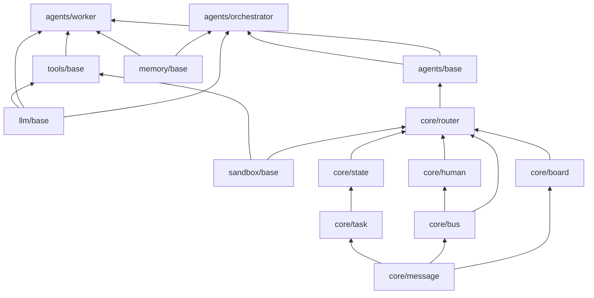

# 接口说明

> 配套代码：`mas/` 目录。设计依据：[design_decisions.md](design_decisions.md)（下文用"§"引用其章节）。
> 现状：**只有类型定义和方法签名**，方法体为 `raise NotImplementedError`。dataclass、枚举、频道工具函数、虚拟工具的 schema、`MockLLM`、`Settings` 已经可以直接使用。
> 规则：**接口改动需要 JIAN Yimin 和 LI Heyang 两人同意**，改完同步更新本文和 `tests/test_interfaces.py`。

---

## 1. 模块总览与负责人

| 文件 | 内容 | 负责人 | 设计依据 |
|---|---|---|---|
| `mas/core/message.py` | `Message`、`MsgType`、各类型 payload、频道函数 | JIAN Yimin | §3 |
| `mas/core/task.py` | `Task`、`TaskResult`、`TaskStatus`、`FailureMode` | JIAN Yimin | §4、§5、§3.1 |
| `mas/core/bus.py` | `MessageBus`、`InMemoryBus` | JIAN Yimin | §3 |
| `mas/core/router.py` | `Router`：中心化路由，纯代码 | JIAN Yimin | §2.1、§5、§7 |
| `mas/core/state.py` | `StateTable`：任务状态表 | JIAN Yimin | §4 |
| `mas/core/board.py` | `SessionBoard`：共享会话看板 | JIAN Yimin | §3.1 |
| `mas/core/human.py` | `HumanIO`、`CliHumanIO`、`HitlRequest`、`HitlKind` | JIAN Yimin | §7 |
| | `AutoResponder` | LI Heyang | §7 |
| `mas/agents/base.py` | `Agent` 基类 | JIAN Yimin | §3、§5、§7 |
| `mas/agents/orchestrator.py` | `Orchestrator` | JIAN Yimin | §2 |
| `mas/agents/virtual_tools.py` | `call_<agent>`、`decline`、`read_group`、`ask_human`、`finish` 的 schema | JIAN Yimin | §2.1、§2.2 |
| `mas/agents/worker.py` | `WorkerAgent`：ReAct 循环 | LI Heyang | §6 |
| `mas/agents/roles.py` | `RoleConfig`、三个角色的配置 | LI Heyang | §1 |
| `mas/memory/base.py` | `Experience`、`Memory`、`JsonlMemory` | JIAN Yimin | §8 |
| `mas/tools/base.py` | `Tool`、`ToolResult` | LI Heyang | §6 |
| `mas/sandbox/base.py` | `Sandbox`、`LocalSandbox`、`DockerSandbox`、`ExecResult` | LI Heyang | §9 |
| `mas/llm/base.py` | `LLMClient`、`LLMResponse`、`ToolCall`、`FunctionSpec` | LI Heyang | §11 |
| `mas/llm/deepseek.py` | `DeepSeekClient` | LI Heyang | §11 |
| `mas/llm/mock.py` | `MockLLM`（已实现） | 共用 | — |
| `mas/eval/harness.py` | `EvalCase`、`EvalRecord`、`run_suite`、`summarize` | LI Heyang | §10 |
| `mas/config.py` | `Settings`（已实现） | 共用 | 各节的上限与待定项 |

### 依赖方向



下层不依赖上层。LI Heyang 负责的 `llm`、`tools`、`sandbox` 都在最底层，不依赖总线和 agent，可以完全独立开发和测试。

---

## 2. 一次请求经过哪些接口

以人类在群里发"调研 X 并写个示例脚本推到 GitHub"为例：

```
CliHumanIO ──publish(CHAT)──▶ MessageBus ──▶ 所有成员收到
                                   │ observer
                                   ├──▶ SessionBoard.on_message      （记录人类原话）
                                   ▼
Orchestrator.should_handle → handle_chat → run_root
   loop:
     LLMClient.chat(messages, function_specs)        ← call_<agent> 的描述里带 Memory.profile()
     LLMResponse.text  ──▶ SessionBoard.set_plan     （剩余步骤）
     LLMResponse.tool_calls（可能多个，并发执行）
        call_researcher ──▶ Router.dispatch(...)
                              ├─ 检查限制、StateTable.register、拷贝 files 到 inbox/
                              ├─ publish(TASK_ASSIGN @researcher)
                              └─ 等待 reply_to 对应的 TASK_RESULT
                                         ▲
WorkerAgent(researcher).on_message → handle_task(task)
   prompt = role.system_prompt + Memory.recall() + Agent.board_text(task) + goal
   loop: LLMClient.chat → Tool.run(sandbox, ...) → ToolResult
         需要授权 → Agent.ask_human → Router.request_human → HITL_REQUEST @human
         需要帮手 → Agent.call_agent → Router.dispatch（同一条路径）
   → TaskResult（artifacts / refs 根据 ToolResult 自动补全）→ publish(TASK_RESULT)
   → Memory.add(Experience)；失败时异步 reflect()
     finish ──▶ SessionBoard.finish_root，交付物拷到 output/，在群里回复
```

---

## 3. 各模块要点

### 3.1 消息 `mas/core/message.py`

`Message` 字段：

| 字段 | 说明 |
|---|---|
| `type` | `MsgType` |
| `sender` | agent_id 或 `"human"` |
| `channel` | `"group:main"` 或 `dm_channel(a, b)` |
| `content` | 显示在聊天里的文字，例如 `"@coder 写一个示例脚本"` |
| `payload` | 结构化数据，**必须能 JSON 序列化**，格式见下表 |
| `receiver` | 必须处理这条消息的成员；`None` 表示没有指定 |
| `mentions` | 正文里解析出的 @名字 |
| `reply_to` | `TASK_RESULT` 指向对应的 `TASK_ASSIGN`；`HITL_RESPONSE` 指向对应的 `HITL_REQUEST` |

payload 格式：

| MsgType | payload | 谁发 |
|---|---|---|
| `CHAT` | `{}` | 人类、agent |
| `TASK_ASSIGN` | `{"task": Task.to_dict()}` | Router |
| `TASK_RESULT` | `{"result": TaskResult.to_dict()}` | Agent 基类 |
| `HITL_REQUEST` | `{"request_id", "task_id", "kind", "question", "options"}` | Router |
| `HITL_RESPONSE` | `{"request_id", "answer"}` | HumanIO |
| `STATUS` | `{"task_id", "status", "note", "public"}` | Agent 基类 |

频道函数：`dm_channel(a, b)` 与参数顺序无关（`dm:coder:human`）；`is_group(channel)`；`dm_members(channel)`。

### 3.2 任务 `mas/core/task.py`

- 每次 `call_<agent>` 产生一个 `Task`。字段里最关键的是：
  - `origin_channel`：根请求来自哪个频道，决定消息是否公开、HITL 在哪里弹出。再委派时由子任务**继承**。
  - `chain`：委派链，用于检查深度和循环。`depth` 属性等于委派层数。
  - `context`：只放这次调用特有的说明；会话的整体进展由看板提供。
  - `files`：交接的文件名，Router 会拷进执行者的 `inbox/`。
- `TaskResult`：`summary` 是 Worker 的最终回答；`artifacts`、`refs` 由代码根据工具调用记录补全；`open_issues` 进入看板的未办事项；被拒绝时 `declined=True` 并填 `suggest`。
- `FailureMode` 由 `TaskResult` 和评测共用，取值见 §10。
- `to_dict()` / `from_dict()` 已实现，测试保证能经过 JSON 来回转换。

### 3.3 总线 `mas/core/bus.py`

| 方法 | 约定 |
|---|---|
| `publish(msg)` | 先存入频道历史、通知所有 observer，再投递给频道的每个成员 |
| `subscribe(agent_id)` | 返回该成员的收件队列 |
| `join(agent_id, channel)` | 加入频道；私聊频道在首次发消息时自动加入双方 |
| `members(channel)` / `history(channel, limit)` | `history` 也是 `read_group` 工具的数据来源 |
| `add_observer(fn)` | `fn` 同步地看到所有频道的每条消息。Router、看板、日志都通过它获取消息，不需要加入每个私聊 |

### 3.4 路由 `mas/core/router.py`（纯代码，不调 LLM）

所有委派，不论来自 Orchestrator 还是 Worker、群聊还是私聊，都走 `Router.dispatch()`：

1. 检查限制：深度、委派链里是否有循环、每个任务的委派次数、同一目标的重试次数。违反时直接返回失败的 `TaskResult`，不联系执行者。
2. 在 `StateTable` 登记；把 `files` 拷到执行者的 `inbox/`。
3. 发 `TASK_ASSIGN`：群聊任务发到 `group:main`，私聊任务发到 `dm_channel(requester, target)`。
4. 在 `subtask_timeout_s` 内等待对应的 `TASK_RESULT`，超时返回 `TIMEOUT` 失败。**任务失败时从不抛异常。**

其他方法：`open_direct_task`（人类私聊或 @ 某个 agent 时登记任务）、`request_human`（HITL，编号 h1、h2……，弹在 `origin_channel`）、`board(session_id)`、`session_of(channel)`、`cancel_root`。

### 3.5 状态表与看板

- `StateTable`：唯一的任务状态来源，只由 Router 写入；`/status`、看板、评测都从这里读。
- `SessionBoard`：通过 observer 收到消息后用代码更新，**不调 LLM**。`render()` 的压缩顺序和保留规则见 §3.1。每个会话一块看板，保存到 `data/sessions/<session_id>/board.json`。

### 3.6 人类端 `mas/core/human.py`

- `HumanIO` 是 id 为 `"human"` 的总线成员，有 `run / show / answer` 三个方法。
- `CliHumanIO` 支持的命令：`/dm <agent> <内容>`、`/status`、`/cancel`、`/reply <编号> <回答>`。
- `AutoResponder` 按 `HitlKind` 立即回复默认答案，并统计 `hitl_count`；`submit()` 供评测框架以人类身份下发任务。

### 3.7 Agent 基类 `mas/agents/base.py`

子类只需实现 `handle_task`（以及需要时的 `handle_chat`）。下面这些服务由基类提供，ReAct 循环不需要直接操作总线：

| 方法 | 作用 |
|---|---|
| `should_handle(msg)` | 只处理 `receiver` 是自己或 @ 到自己的消息（已实现） |
| `on_message(msg)` | `TASK_ASSIGN` → `handle_task` → 发 `TASK_RESULT`；任何异常都转成 `CRASH` 结果，保证不会让整个系统崩溃 |
| `report_status(task, status, note, public)` | `public=True` 只用于收到、完成、失败、等待人类这几个节点 |
| `ask_human(task, question, kind, options)` | 转给 `Router.request_human`（已实现） |
| `call_agent(task, target, goal, context, files)` | 再委派，转给 `Router.dispatch`（已实现） |
| `board_text(task)` | 当前会话看板的文本（已实现） |

### 3.8 虚拟工具 `mas/agents/virtual_tools.py`（schema 已实现）

LLM 能看到、但不属于 `Tool` 子类的工具：

| 工具 | 谁能用 | 由谁处理 |
|---|---|---|
| `call_<agent>(goal, context, files)` | Orchestrator；Worker（不含调用自己） | `Router.dispatch` |
| `decline(reason, suggest)` | Worker，仅限第一步 | Worker 直接返回 `declined` 结果 |
| `read_group(limit)` | Worker | `MessageBus.history` |
| `ask_human(question, options)` | Orchestrator | `Router.request_human`（澄清） |
| `finish(summary, deliverables)` | Orchestrator | 结束根任务 |

`call_agent_spec(role, profile)` 会把记忆生成的能力档案拼进工具描述里；`target_of("call_coder") == "coder"`。

### 3.9 Worker `mas/agents/worker.py`、`roles.py`

- `WorkerAgent(role, bus, router, settings, llm, tools, sandbox, memory)`。
- `handle_task` 的步骤写在 docstring 里，对应 §6：召回记忆、注入看板、最多 12 步、需要授权的工具先请求人类批准、同一工具连续失败 2 次时求助、补全 `artifacts/refs`、写入记忆、失败时异步 `reflect()`。
- `function_specs(task)`：真实工具 + 其他 agent 的 `call_<agent>` + `decline` + `read_group`。
- `RoleConfig.capability` 是 Orchestrator 看到的能力描述；`system_prompt` 还没写（`TODO(LI Heyang)`）。

### 3.10 Orchestrator `mas/agents/orchestrator.py`

- `handle_chat`：处理 `/status`、`/cancel`、任务进行中的插话，其余消息开启 `run_root`。
- `run_root` 的循环写在 docstring 里，对应 §2.1：一轮中的多个 `call_<agent>` 用 `asyncio.gather` 并发执行；`resp.text` 作为剩余计划写进看板；回给 LLM 的只有摘要、产物和是否成功；轮数用完时按 `MAX_ROUNDS` 汇报。

### 3.11 工具 `mas/tools/base.py`

- `Tool` 的属性：`name`、`description`、`parameters`（JSON Schema）、`requires_approval`。
- `async run(sandbox, **kwargs) -> ToolResult`：预期内的失败返回 `ok=False`，**不要抛异常**。
- `ToolResult.files_written` 和 `refs` 会被汇总进 `TaskResult`，所以写文件、git 提交的工具必须填写。
- `spec()` 已实现，返回 `FunctionSpec`。
- 角色配置里用到的工具名：`web_search`、`fetch_url`、`read_file`、`write_file`、`delete_file`、`list_files`、`run_python`、`git`。

### 3.12 沙箱 `mas/sandbox/base.py`

- 所有路径都相对于 agent 的 workspace 根目录；`resolve()` 发现越界时抛 `PermissionError`。
- `exec(cmd, timeout, env)` 不会因返回码非零或超时而抛异常，结果统一用 `ExecResult` 表示。
- `import_file(src, name)` 只有 Router 调用，用于把上游产物拷进 `inbox/`。
- `DockerSandbox` 继承 `LocalSandbox` 的文件操作（workspace 用 bind mount 挂载），只重写 `exec`，在常驻容器里执行。用哪个由 `Settings.sandbox_backend` 决定。

### 3.13 记忆 `mas/memory/base.py`

- `Experience.tags` 根据用到的工具自动打标签（例如 `["code", "git"]`），不调 LLM。
- `recall(query, k)` → 注入 Worker 的 prompt；`profile(max_chars)` → 拼进 `call_<agent>` 的描述。两者都不调 LLM。
- 存储位置：`data/memory/<agent_id>.jsonl`。

### 3.14 LLM `mas/llm/`

- 消息使用 OpenAI 格式（`{"role": ..., "content": ...}`），DeepSeek API 可以直接接受。
- `chat(messages, tools, temperature) -> LLMResponse`：内部负责重试、退避和 tool call JSON 修复；彻底失败时才抛 `LLMError`。
- `LLMResponse.tool_calls` 是列表，可能包含多个调用，调用方应并发执行。`text` 可以和 tool call 同时存在（Orchestrator 用它写剩余计划）。
- `MockLLM(script=[...], responder=fn)` 已实现：按顺序返回预设的响应，用完后调用 `responder`；`calls` 记录每次调用，方便断言。

### 3.15 评测 `mas/eval/harness.py`

- `EvalCase(id, prompt, category, checker)`：`checker(output_dir) -> bool`；为 `None` 时以"无失败完成"作为成功标准。
- `EvalRecord` 记录：是否成功、子任务总数和完成数、耗时、Orchestrator 轮数、HITL 次数、失败模式。
- 每个用例使用新会话，只有记忆跨用例保留（§10）。

### 3.16 配置 `mas/config.py`（已实现）

所有上限和待定项都是 `Settings` 的字段，确定后只改配置，不改接口：

| 字段 | 默认值 | 对应 |
|---|---|---|
| `max_orchestrator_rounds` / `max_worker_steps` | 8 / 12 | D11 |
| `subtask_timeout_s` | 180 | 待确认 |
| `max_delegation_depth` / `max_delegations_per_task` / `max_retries_same_goal` | 2 / 2 / 2 | §5、D10 |
| `result_summary_max_chars` / `board_max_chars` / `tool_output_max_chars` | 1500 / 2000 / 4000 | §2.1、§3.1、§6 |
| `memory_recall_k` / `profile_max_chars` | 3 / 300 | §8、§2.3 |
| `sandbox_backend` | `"local"` | 待确认 |
| `deepseek_model` / `orchestrator_model` | `deepseek-chat` / 空（与前者相同） | 待验证 |
| `auto_hitl` | `False` | 评测时设为 `True` |

`Settings.from_env(**overrides)` 读取 `.env` 中的变量（见 `.env.example`），遇到未知字段直接报错。运行时数据统一放在 `data/` 下（已在 `.gitignore` 中）。

---

## 4. 全局约定

1. **全部使用 async**：涉及 I/O 的方法都是 `async`；一个 agent 可以同时处理多个任务。
2. **失败用返回值表示，不抛异常**：工具返回 `ToolResult(ok=False)`，任务返回 `TaskResult(success=False, failure_mode=...)`。只有程序 bug 才会抛异常，并在 `Agent.on_message` 里被兜底为 `CRASH`。
3. **只在以下几处调 LLM**：Orchestrator 的每一轮、Worker 的每一步、失败后的异步反思。路由、看板、状态表、记忆召回、能力档案、"收到"之类的通知，都不调 LLM。
4. **payload 必须能 JSON 序列化**：`Task` 和 `TaskResult` 通过 `to_dict()` 放进 payload。
5. **代码中的 agent_id 固定为**：`orchestrator`、`researcher`、`coder`、`writer`、`human`。

---

## 5. 如何并行开发

- **LI Heyang**：`llm`、`tools`、`sandbox` 不依赖总线，可以直接写单元测试。`WorkerAgent.handle_task` 可以用 `MockLLM` 加一个桩 Router（只需实现 `dispatch`、`request_human`、`board`）单独测试。
- **JIAN Yimin**：`bus`、`router`、`state`、`board`、`orchestrator` 可以用 `MockLLM` 加一个桩 Worker（`handle_task` 直接返回固定的 `TaskResult`）打通整个流程。
- **联调**：两边都完成后，把桩替换成真实实现，用 `MockLLM` 先跑通，再换成 `DeepSeekClient`。
- 运行测试：`python3 -m unittest`（安装 dev 依赖后也可以用 `pytest`）。
